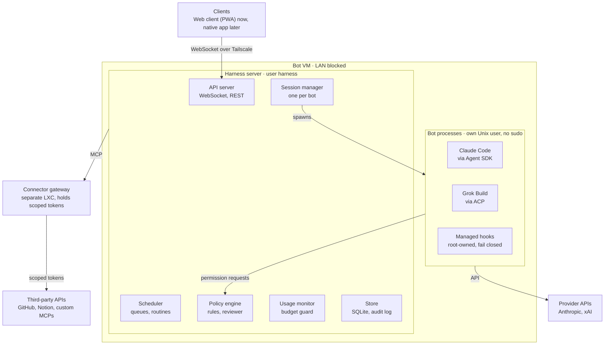
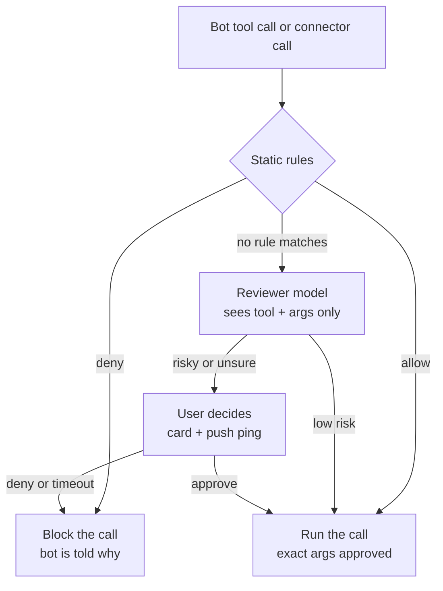

# Aphelion: Architecture and Development Plan

Last updated Nov 21, 2026

This is a living document. It grows as decisions are made, and once the repo exists, the decisions it records move into decision records under `docs/`.

> **Amendments.** This plan was imported unchanged under [decision 0004](../decisions/0004-import-plan-with-m0-plan.md). Later decision records change parts of it. Each changed passage links the record that changed it. In tables, the original text is struck through next to the new text. In prose, an "Amended by" note follows the new text and quotes the original. Text with no mark is the plan as imported, except that [decision 0039](../decisions/0039-bots-not-agents.md) renamed "agent" to "bot" throughout, without marks.

## Goals and scope

Aphelion is a self-hosted bot application, not a coding app. Its bots are persistent managers and orchestrators: they plan work, track it across connected services, coordinate with each other, delegate hands-on coding to dedicated tools such as T3 Code through MCP, and follow up. Claude Code and Grok Build are the engines underneath, running on a headless VM, with every risky action gated by an approval layer the user configures and controls.

**Must do (v1)**

- Ship the server as one container image, reachable over Tailscale, and clients (the PWA and the desktop app) that connect to it. The desktop app never runs a server itself.

  > Amended by [decision 0017](../decisions/0017-desktop-remote-only.md), with the container from [decision 0016](../decisions/0016-one-docker-container.md). The original said: "Ship one app with two modes: launched with a CLI flag it runs headless (for example as a systemd service on a bot VM, reachable over Tailscale); launched normally it opens the desktop app."

- Be plugin-first: every feature is a plugin on a public, versioned API, and the UI is fully themeable, down to animations in the chat panel.
- Drive multiple AI CLIs through one adapter interface, starting with Claude Code and Grok Build, using their existing subscription logins.
- Keep persistent bots: each has a name, instructions, a workspace, and resumable session history.
- Let bots specialize, as Grok Bot does. Each bot has its own list of connectors and plugins, and sees only those. A new bot starts with none, and the owner switches on what it needs. For example, one bot works on GitHub and another on email and calendars. A plugin's permissions are approved once for the whole server, and each bot has an on/off switch for each plugin and connector. Finer limits, such as one bot read-only on GitHub, come from the policy engine's rules. A bot's setup can be saved to a preset file and imported later. The file never carries an approval, grant or secret, so importing it asks the owner to approve anything missing ([decision 0058](../decisions/0058-specialized-bots.md)).
- Let bots message each other and hand off tasks, under the same approval rules as everything else.
- Queue messages per bot, with pause, resume and cancel.
- Run routines on schedules (cron-style) and on demand, with run history.
- Show subscription usage per provider: current window, weekly cap, reset times.
- Connect services through native connectors (GitHub first) and any custom MCP server the user adds, such as a coding tool's MCP server.
- Show the work in the app: a live map of bots and what they're doing, and pull requests and issues from connected repos.
- Gate risky tool calls and connector calls through a configurable approval layer: auto-allow, reviewer model, or ask the user.
- Serve a web client first, with a protocol a native app can reuse later.

**Not in v1**

- Coding features: code editor, diff review, terminals. Coding is delegated to dedicated tools over MCP.
- A macOS or Windows server. The server stays on Linux in Docker. The desktop app builds for macOS and Windows.

  > Amended by [decision 0060](../decisions/0060-server-stays-on-linux-with-api-keys-and-two-plugin-fixes.md). The original said: "macOS and Windows (the isolation model relies on Linux users, systemd and root-owned configs)."
- Voice, embedded browser, computer use.
- Multi-user accounts, teams, or anything public-facing.
- Native mobile app and WebRTC (protocol is designed for them; built later).
- Shared multi-bot group channels (direct messages and handoffs between bots are in v1).
- Merging or reviewing pull requests from inside the app (v1 shows them and links out).

**Design principles**

- **Extremely opinionated.** Aphelion makes the hard choices for the user instead of hiding them behind options: approvals on by default, bots unprivileged and isolated, credentials never on the bot host, ~~ACP for bots~~ each CLI driven over its vendor's own protocol ([0034](../decisions/0034-vendor-protocol-per-cli.md)), MCP for tools, design tokens for every pixel. Plugins and themes extend it within those rules; they don't relax them.
- **Bots manage; tools build.** Bots break work down, file and triage issues, coordinate other bots, delegate implementation to coding tools over MCP and check the results. Aphelion has no code editor, diff viewer or terminal UI, and doesn't try to.
- **The bots are untrusted.** Enforcement lives outside their reach (root-owned config, separate machine for credentials).
- **Minimal attack surface.** Every feature added must justify its attack surface and maintenance cost.
- **Swappable edges.** Adapters, transports and stores sit behind interfaces so a CLI change or a new client touches one module.

## Documentation and planning

Documentation and planning are the most critical parts of the project: nothing is built without a written plan, and nothing ships without its docs.

**Rules**

- **Plan before code.** Every milestone opens with a short written plan (scope, design notes, risks, open questions), and every significant design choice gets a decision record before implementation starts.
- **Docs ship with the change.** A pull request that changes behavior, config, the protocol or a public API updates the docs in the same PR. CI fails if the docs don't build or links break.
- **Generated where possible.** The plugin API reference and protocol spec are generated from the TypeScript types, so they can't drift from the code.
- **Written for the user.** Docs describe what the user does and sees, in plain language, with examples; internals live in the architecture and decision records.

**The doc set**

| Doc | Audience | Contents |
| --- | --- | --- |
| README | Everyone | What Aphelion is (and isn't), a quick start, links to everything else |
| Install guides | Users | Headless server setup, desktop app, Tailscale, gateway host, upgrades and backups |
| User guide | Users | Bots and their connectors and plugins, approvals and presets (policy modes and bot presets), connectors, custom MCP servers, routines, usage, the bot map and Work view |
| Security and threat model | Users, contributors | What the isolation protects, what it doesn't, and how to report a vulnerability |
| Architecture overview | Contributors | This plan's architecture, kept current as the code changes |
| Decision records | Contributors | One numbered record per significant decision: context, options, choice, consequences |
| Protocol spec | Client and plugin authors | Commands, events and versioning, generated from the protocol package |
| Plugin, connector and theme guides | Plugin authors | Starter templates, permissions, UI slots, tokens, plus the generated API reference |
| Changelog | Everyone | Every release, with breaking changes and migration steps called out |

**Where it lives**

- A `docs/` folder in the repo, built into a versioned docs site with Starlight, published with every release.
- This plan moves into `docs/plan/`, and the decisions already made here become the first decision records.
- Issue and pull request templates ask for the plan link, the docs touched and the decision record when there is one.

## Development workflow

Work flows from a planned issue to a small pull request into `dev`, and from `dev` to `main` only as a reviewed release. Coding tools such as T3 Code do the implementation; the user approves plans, decisions, pull requests and releases.

**Branches**

| Branch | Purpose | Rules |
| --- | --- | --- |
| `main` | Released code; every commit is a tagged release | Protected. Changes only through a release PR from `dev` or a hotfix PR. |
| `dev` | Integration branch; always green and runnable | Protected. Changes only through PRs, squash-merged, with CI passing and approval. |
| `feat/<issue-id>-<slug>` | One issue's feature work, e.g. `feat/M3-04-github-app` | Branched from `dev`, deleted after merge. |
| `fix/`, `docs/`, `spike/`, `chore/` | Same pattern for fixes, docs-only work, spikes and maintenance | Spikes may never merge; their finding goes into the docs. |
| `hotfix/<slug>` | Urgent fix to a release | Branched from `main`, merged to `main`, then `main` merged back into `dev`. |

**The flow for a feature**

1. The milestone plan (M#-00) is approved, so the issue's scope is settled.
2. A branch is created from `dev` for exactly one issue.
3. The pull request into `dev` links the issue, describes what changed and how it was tested, and updates the affected docs.
4. CI must pass: lint, typecheck, unit and contract tests, docs build and link check.
5. The user approves, and the PR is squash-merged into `dev` with a Conventional Commit title (`feat:`, `fix:`, `docs:`), which feeds the changelog.
6. When a milestone's exit criterion passes on `dev`, a release PR from `dev` into `main` is opened with the changelog. The user approves it, it's merged, and `main` is tagged (`v0.1.0` and so on).

**What the user approves**

| Item | Approval | What to check |
| --- | --- | --- |
| Milestone plans (M#-00) | Always required | Scope matches the plan, risks are named, issues are small enough |
| Decision records | Always required | Options were weighed, and the choice fits the design principles |
| PRs into `dev` | Required unless the PR qualifies for bot approval; full review for anything labeled `risk/security` | Meets the issue's acceptance criteria, tests cover them, docs updated, no scope creep (no coding-app features) |
| Security-sensitive PRs | Full line-by-line review | Policy engine, secrets broker, gateway, plugin permissions, auth, install script, anything adding a permission, secret or network host |
| Release PRs into `main` | Always required | Milestone exit test passed, changelog accurate, upgrade notes written |

Coding tools open PRs but never approve or merge them. A manager bot may approve and merge into `dev` only under the bot approval rules below; only the user merges into `main`.

**Bot approvals**

A manager bot can approve and merge low-risk PRs into `dev`, so the user's attention goes to plans, decisions, security-sensitive changes and releases.

- **`dev` only, never `main`.** Release PRs stay with the user, so nothing ships without a human, and anything a bot wrongly approved is caught at release or reverted on `dev`.
- **Eligible PRs only:** CI fully green, under the size limit, no new dependencies, and no changes to security-sensitive paths (policy engine, secrets broker, gateway, auth, plugin permissions, install script) or new permissions and network hosts. Code owners block those automatically.
- **Author and reviewer must differ:** a different bot, ideally on a different engine, so a Grok-written PR gets a Claude review and the reverse.
- **The PR is untrusted input.** The reviewing bot treats the diff, comments and description as data, never as instructions, and an instruction-like text in a PR fails the review.
- **The user stays informed:** a daily digest lists every bot-approved merge, each revertible with one click.
- **Enforced by Aphelion itself:** merging is a destructive action in the GitHub connector, so these rules are a policy rule that allows a manager bot to merge into `dev` when every condition holds. The audit log records each decision.

**Rollout**

1. First milestone: every PR needs the user's approval.
2. Then: bot approval for docs-only and test-only PRs.
3. Then: small feature PRs, widened or tightened based on how often bot-approved merges get reverted.

**How small the work should be**

- **One issue, one PR, one concern.** A PR never mixes a refactor with a feature, or two features.
- **Small diffs:** aim for under about 400 changed lines, not counting tests and generated files. Anything bigger is split into sub-issues or stacked PRs that each pass CI on their own.
- **Always shippable:** every PR leaves `dev` green and runnable. Unfinished features hide behind a feature flag rather than waiting on a long-lived branch.
- **Size check:** an issue a coding tool can't finish in one focused session, or that touches more than one package, gets split during milestone planning.
- **Spikes are timeboxed** and end with a written finding, not production code.

**Templates and automation**

- PR template: linked issue, plan or decision record link, what changed, how it was tested, docs touched, risk label, and screenshots for UI changes.
- Code owners: security-sensitive paths require the user's review.
- Labels: `risk/security`, `risk/breaking`, `agent-authored`, plus the area and type labels from the issue breakdown.
- Semantic versioning: 0.x releases until v1.0, with breaking changes called out in the changelog.

## Architecture overview

One harness process on the bot VM drives unprivileged CLI bots, credentials live on a separate gateway, and every risky call passes the policy engine.

Clients reach the harness only over Tailscale. Bots send permission requests back to the policy engine and reach third-party services only through the gateway.

**One app, two modes.** The server runs on Linux only. The desktop app runs on Linux, macOS and Windows. Aphelion runs only as the server container, with its protections, and every client connects to it. The server runs on Bun as `aphelion --headless`. The desktop app is Electron wrapping the same web client that the PWA serves. It connects to a server over Tailscale and never bundles or starts one. To use Aphelion on one machine, run the container on that machine and connect the desktop app to it. Electron is the shell because it renders with the same Chromium engine on every Linux distro. The server never loads Electron, so a server needs no GUI libraries.

> Amended by [decision 0007](../decisions/0007-bun-runtime.md) (Bun), [decision 0009](../decisions/0009-electron-desktop-shell.md) (why Electron), [decision 0017](../decisions/0017-desktop-remote-only.md) (no local mode) and [decision 0060](../decisions/0060-server-stays-on-linux-with-api-keys-and-two-plugin-fixes.md) (the desktop app also runs on macOS and Windows). The original said: "v1 supports Linux only. The same Aphelion install runs headless when started with `aphelion --headless` (server only, for a VM or an always-on machine) and otherwise opens the desktop app. The desktop app wraps the same web client and either starts a local server or connects to a remote headless instance over Tailscale. In local mode the gateway and bots still run as separate Unix users on the same machine, which is weaker isolation than a separate gateway host, and the client says so. Electron is the default shell because the server already runs on Node, but headless mode must start the Node server without loading Electron, so a server VM doesn't need any GUI libraries."

## Components

The harness is one server process with a handful of modules, plus a connector gateway on a separate machine. Each module sits behind an interface so it can be swapped or tested alone.

| Component | Responsibility | Key design choices |
| --- | --- | --- |
| API server | Serves clients: commands in, events out | WebSocket for streaming, REST for everything else. Binds to the tailnet only. Device identity from Tailscale, plus a per-device token so a lost phone can be revoked. |
| Bot registry | Defines each bot | Name, provider, model, instructions, workspace path, policy profile, and the connectors and plugins the bot may use, none by default ([0058](../decisions/0058-specialized-bots.md)). Stored as YAML in git, loaded into SQLite. |
| Bot adapters | Talk to the AI CLIs | ~~[ACP](https://agentclientprotocol.com/) client first: Grok via `grok agent stdio`, Claude via an ACP adapter. Fallback: `-p --output-format stream-json` with `--resume`.~~ Each CLI over its vendor's own protocol ([0034](../decisions/0034-vendor-protocol-per-cli.md)): Claude Code through the Claude Agent SDK, Codex through `codex app-server`, Grok via `grok agent stdio` ([ACP](https://agentclientprotocol.com/)). One normalized event type out. |
| Session manager | Owns bot processes | One live process per bot, ~~run as that bot's Unix user~~ run as the shared `aphelion-bot` user and started by the bot runner ([0006](../decisions/0006-shared-bot-user.md), [0016](../decisions/0016-one-docker-container.md)). Restart on crash, resume by session id, kill the whole process tree on cancel. |
| Queue | Orders work per bot | FIFO per bot, one turn at a time. Pause, resume, cancel, reorder. Survives restarts. |
| Scheduler | Runs routines | Routine = bot + prompt + schedule + policy profile. Cron expressions in an explicit time zone. Missed-run and overlap policy per routine. Run history kept. |
| Usage monitor | Tracks subscription headroom | One collector per provider, polled on a timer, stored as snapshots. Budget guard can pause routines near a cap. |
| Policy engine | Decides every gated action | Inputs: ~~ACP permission requests~~ each adapter's permission requests ([0034](../decisions/0034-vendor-protocol-per-cli.md)) and hook callbacks. Order: static rules, then reviewer, then you. Rules, reviewer and timeout behavior are configurable per bot, connector and tool. Every decision logged. |
| Reviewer | Second opinion on risky calls | A separate model call that sees only the action and its arguments, never the content that triggered it. No tools of its own. |
| Connector gateway | Holds third-party credentials | Separate LXC or VM. Runs the native connectors (GitHub first) and any custom MCP servers the user adds, and exposes their tools to bots through the harness MCP endpoint. Scoped tokens, read-only by default, writes routed through the policy engine. |
| Store | Persists state | SQLite in WAL mode: bots, messages, runs, approvals, usage snapshots, audit log. CLI transcripts stay in the CLIs' own files, referenced by session id. No secrets in the database. |
| Notifier | Gets your attention | Push via ntfy now, APNs/FCM later. Sends only "approval waiting" or "routine failed", never the details. |

## Client protocol and transport

Design the protocol once and treat the transport as replaceable: WebSocket over Tailscale for v1, WebRTC data channels later carrying the same messages.

**Protocol rules**

- Clients send commands; the server sends events. Every event has a server-assigned, increasing sequence number.
- On reconnect, a client sends its last sequence number and the server replays what it missed. This handles phones dropping off mobile data and app backgrounding.
- Commands carry a client-generated id so a retried command is applied once.
- Version the protocol from day one (`v: 1` on every frame).

**Event and command types (v1)**

| Kind | Name | Carries |
| --- | --- | --- |
| Command | `message.send` | bot, text, attachments |
| Command | `queue.pause` / `queue.resume` / `queue.cancel` | bot, optional item id |
| Command | `approval.decide` | approval id, allow or deny, optional scope (once / this session) |
| Command | `routine.run` / `routine.update` | routine id, definition |
| Command | `work.assign` | issue or PR reference, target bot |
| Event | `bot.output` | streamed text, tool call start and end, turn complete |
| Event | `bot.status` | bot, state (idle, thinking, running a tool, waiting for approval, error), current task |
| Event | `bot.message` | from bot, to bot, thread id, text, hop count |
| Event | `approval.requested` | approval id, bot, tool, arguments, reviewer verdict, expiry |
| Event | `approval.resolved` | approval id, decision, who decided |
| Event | `routine.run` | routine id, status, summary |
| Event | `usage.snapshot` | provider, window, percent used, reset time |
| Event | `work.updated` | connector, repo, changed pull requests and issues |

**Transport plan**

1. v1: WebSocket over Tailscale, served by the harness. No public exposure, encryption and NAT traversal from Tailscale.
2. Native app: the same WebSocket, with the phone on Tailscale. Optionally embed Tailscale in the app later.
3. Only if needed: WebRTC data channels with your own signaling and a TURN relay. This needs a publicly reachable relay, so it costs some of the isolation.

**Push notifications**

A closed native app can only be woken through APNs or FCM, which run through Apple's and Google's servers. Send a content-free ping ("approval waiting"), and have the app fetch details over Tailscale.

## Security model

Assume every bot can be prompt-injected, so the bots get nothing they could misuse: no root, no credentials, no way to change the rules that gate them.

**Trust boundaries**

- **Hypervisor host and firewall (trusted):** enforces LAN isolation; the VM can't change it. Firewall rules live on the host, outside the VM.
- **Harness user on the VM (trusted):** owns the server, the policy engine, the database and the CLI configs. Bots can't write to its files.
- **Bot user (untrusted):** every bot runs as one shared `aphelion-bot` user with no sudo. Bots can read and write each other's workspaces. They can't read or write the harness's config, database, audit log, policy file or managed hooks.

  > Amended by [decision 0006](../decisions/0006-shared-bot-user.md). The original said: "**Bot users (untrusted):** one Unix user per bot, no sudo, write access only to their own home and workspace."

- **Connector gateway (trusted, separate machine):** the only place OAuth tokens and API keys for third-party services live.
- **Clients (trusted, revocable):** your laptop and phone, identified by Tailscale plus a per-device token that expires.

**Enforcement layers, outermost first**

1. Network: the host firewall blocks the LAN and allows only the gateway host; consider an outbound allowlist for the provider APIs.
2. Credentials: tokens on the gateway, scoped and read-only by default; GitHub branch protection as a backstop.
3. Harness policy: ~~ACP permission requests~~ each adapter's permission requests ([0034](../decisions/0034-vendor-protocol-per-cli.md)) routed to the policy engine. The harness never starts a bot in a bypass or always-approve mode.
4. CLI hooks: root-owned managed settings (`/etc/claude-code/managed-settings.json`, `/etc/grok/requirements.toml`) with a fail-closed `PreToolUse` hook that calls the policy engine. This catches anything that skips layer 3.
5. Recovery: VM snapshots and backups of anything a bot can write to.

**How a gated call is decided**

Every decision goes to the audit log with the exact tool, arguments and who decided. By default, only a rule, the reviewer or the user can release a call.

> Amended by [decision 0035](../decisions/0035-codex-login-sandbox-approvals.md). A Codex escalation request (a request to run a command outside Codex's sandbox) skips this flow. Only the user can approve it, every time, with the exact command shown. No rule and no reviewer may release it. The managed hook's policy check is a separate step and can't approve it either.

The reviewer can only release low-risk calls. Make destructive actions (deletes, sends, merges, permission changes) static rules that always reach you or are always denied.

**Configurable approvals**

The flow above is the default. Every part of it is configurable, so each user decides how much autonomy each bot gets.

| Setting | Options | Default |
| --- | --- | --- |
| Mode preset | Strict (every write asks), Balanced (rules, then reviewer, then the user), Autonomous (only destructive actions ask), Off | Balanced |
| Scope | Global default, then per bot, per connector, per tool; the most specific setting wins | Global only |
| Rules | Match on bot, tool, connector and arguments (path globs, branch names, recipients); action is allow, review, ask or deny | Built-in rules per connector |
| Hard floor | Global deny rules that no lower scope or preset can override | Secrets, settings and workflow changes denied |
| Reviewer | On or off, which model, which risk classes it may release | On, write actions only |
| Timeout | Per rule: how long to wait, and deny or allow when nobody answers | 15 minutes, then deny |
| Grant length | Once, this session, for a set time, or always (saved as a new rule) | Once |
| Approvers | Web card, push notification, native app later | Web card + push |

- Rules live in a versioned policy file that the web client edits; both stay in sync.
- Only an authenticated client can change policy. Bots can never edit it, and every policy change is logged.
- Off is allowed only for bots with no connectors and a disposable workspace, and the client shows a persistent warning while it's on.

## Credentials and vaults

Every secret goes through one secrets broker on the gateway host. Bots can name a secret but never see its value, and the broker reads from a local encrypted store, 1Password or Bitwarden.

**Secrets broker**

- Runs on the gateway host as its own user. Only connectors and the harness can call it; bots can't.
- Config, logs and the database hold references, never values: `op://AI Agents/GitHub App/private key`, `bws://<secret id>`, `local://github/webhook-secret`.
- Values live in a `Secret` wrapper type that redacts itself in logs and JSON, and are never serialized.
- Values are cached in memory with a short TTL, so a rotation in the vault takes effect without a restart.

**Backends**

| Backend | Use for | Auth | TypeScript support |
| --- | --- | --- | --- |
| Local encrypted store | Secrets you enter directly; offline fallback | Key unsealed at boot from systemd encrypted credentials | `age`-encryption npm package |
| 1Password | Your existing keys and logins, in a dedicated AI Agents vault | Read-only service account limited to that vault | Official JavaScript SDK with service accounts; alternatives are the `op` CLI as a subprocess, or a self-hosted 1Password Connect server's REST API |
| Bitwarden Secrets Manager | API keys and machine secrets | Machine account access token scoped to one project | Official Node bindings (`@bitwarden/sdk-napi`, beta) |
| Bitwarden password vault | Personal logins | `bw` CLI | No public SDK; the vault SDK is internal to Bitwarden |

Start with the local store and 1Password through its official SDK. Add Bitwarden behind the same interface later.

**Secure entry, like Grok Bot's secure forms**

- When a connector needs a secret you haven't stored, the client shows a secure form that posts straight to the broker. The value never passes through chat, a bot or the harness database.
- The first time a connector asks for a secret, you approve it once or always for that connector, and the decision is logged.

**Website logins (later)**

Grok Bot fills logins through 1Password in its own browser without the agent seeing the password. That needs a browser in the harness, which is out of scope for v1. If you add one, fill credentials at the browser layer with a per-fill approval, never by handing them to the bot.

**The bootstrap secret**

The broker needs one secret to unlock everything else: the age key of its local encrypted store. Provider tokens, such as the 1Password service account token, are kept apart from it. Store it with systemd encrypted credentials (`systemd-creds`, loaded with `LoadCredentialEncrypted=`). On a VM with a vTPM it can be bound to the TPM; without one it is bound to a host key. Keep it out of env files and shell history. Rotation waits until after M0.

> Amended by [decision 0050](../decisions/0050-bootstrap-key-is-the-store-key.md). The original said: "The broker needs one secret to unlock everything else: the 1Password service account token or the Bitwarden access token. Store it with systemd encrypted credentials (`systemd-creds`, loaded with `LoadCredentialEncrypted=`). On a VM with a vTPM it can be bound to the TPM; without one it is bound to a host key. Keep it out of env files and shell history, and rotate it on a schedule."

## Native connectors

Connectors are built into the harness, not bought from a third party: each one is a module in the connector gateway that holds its own credentials and exposes tools to bots over MCP, with every call passing the policy engine.

**Connector framework**

Every connector implements the same interface, so GitHub, Forgejo, Notion and Gmail plug in the same way.

- **Manifest:** id, display name, auth type, and a list of tools. Each tool declares a risk class (read, write or destructive) and the exact provider permission it needs.
- **Auth flow:** how you connect it from the client (device flow, app install, OAuth web flow), shown as a card in the Connections page.
- **Credential store:** encrypted at rest on the gateway host, never sent to the VM. Bots only ever see results.
- **Tool handlers:** the code that calls the provider API, returning trimmed, typed results instead of raw API dumps.
- **Event source (optional):** webhook or polling, so routines can trigger on "new issue" or "PR review requested".
- **Per-tool policy:** allow, reviewer or ask you, editable per connector and per bot in the Connections page.

Bots reach connectors through one MCP endpoint the harness hosts. Each bot session gets its own short-lived bearer token for that endpoint, so the harness knows which bot made each call. The endpoint offers a bot only the connectors that bot may use, and refuses calls to any other ([decision 0058](../decisions/0058-specialized-bots.md)).

**GitHub connector design**

Use your own private GitHub App, installed only on the repos you choose. The gateway keeps the app's private key and mints a fresh installation token for each call, narrowed to the one repo and the one permission that call needs. Installation tokens expire after one hour and can't exceed what the app was granted.

- **Acting as the app (default):** bot actions show up as the app's bot account, which keeps a clean audit trail separate from your own activity.
- **Acting as you (optional):** a user access token via device flow, for things only your account can do. These expire after 8 hours with a 6-month refresh token, so keep it off unless needed.
- **Git access:** bots still clone and push with plain git. A git credential helper on the VM asks the harness for a token per operation: fetch gets a read-only token, push goes through the policy engine first. No long-lived git credential ever lands on the VM. The helper gives no token to a bot that doesn't have the GitHub connector switched on ([decision 0058](../decisions/0058-specialized-bots.md)).
- **Events:** start with polling (notifications and repo events every few minutes). Webhooks need a public URL, which means Tailscale Funnel or a relay; add that later if polling is too slow.
- **Backstops:** branch protection on default branches, and never grant the app Administration, Secrets or Workflows permissions.

**GitHub tools and default policy**

| Tool | Risk | Default policy | Token permission |
| --- | --- | --- | --- |
| List repos, read files, search code | read | allow | Contents: read |
| Read issues, PRs, reviews, CI status | read | allow | Issues, Pull requests, Checks: read |
| Clone or fetch (credential helper) | read | allow | Contents: read |
| Create issues, edit labels, assignees and milestones | write | reviewer | Issues: write |
| Comment on an issue or PR | write | reviewer | Issues or Pull requests: write |
| Create a branch, push to `bot/*` branches | write | reviewer | Contents: write |
| Open a pull request | write | reviewer | Pull requests: write |
| Push to the default branch, merge a PR | destructive | ask you | Contents: write |
| Close issues, delete branches | destructive | ask you | Issues or Contents: write |
| Change settings, secrets or workflows | n/a | not available | never granted to the app |

Issue and project management tools come first, because that's most of what manager bots do. Branch and PR tools exist for small changes; real implementation work is delegated to coding tools.

**Custom MCP servers**

Any MCP server can be added as a custom connector, such as T3 Code's MCP server or a self-hosted service. It goes through the same gateway, secrets broker and policy engine as the native connectors.

- **Transports:** local stdio servers run on the gateway host under their own Unix user. Remote servers connect over Streamable HTTP, with the gateway acting as the OAuth client when the server requires sign-in.
- **Credentials:** API keys and tokens come from the secrets broker and are injected as environment variables or headers when the gateway starts or calls the server. Bots never see them.
- **Tool discovery:** the gateway lists the server's tools in the Connections page, where the user enables tools per bot.
- **Risk classes:** new tools default to "ask". The server's tool annotations (read-only or destructive hints) can suggest a class, but they come from the server, so they're treated as hints, not trusted.
- **Pinning:** the gateway stores a hash of each tool's name, description and input schema. If a server changes an approved tool, that tool is disabled until the user reviews the change.
- **Network:** the gateway, not the bot VM, reaches the MCP server. A LAN service like a T3 Code instance only needs a firewall rule from the gateway host, so the bot VM stays isolated.
- **Scoping:** each custom server can be enabled for specific bots only. No bot has one until the owner switches it on ([decision 0058](../decisions/0058-specialized-bots.md)).

## Plugins and themes

The harness is plugin-first. Core features ship as first-party plugins on the same public API third-party plugins use, and every visual detail, including animations in the chat panel, comes from themes and UI plugins.

**Plugin-first core**

- The core provides only the plugin host, event bus, storage, policy engine and secrets broker. Everything else is a plugin: bot adapters, connectors (GitHub, custom MCP), secret backends, notifiers, routine triggers, reviewers and UI panels.
- Building first-party features on the public API keeps it honest. If GitHub can't be built as a plugin, the API is missing something.
- The plugin API is versioned with semver from day one, and each plugin declares the API range it supports.

**Plugin types**

| Type | What it adds | Runs where | Isolation |
| --- | --- | --- | --- |
| Theme | Colors, type, spacing, motion, icons, chat backgrounds, declarative animations | Client | Data only, no code |
| UI plugin | Panels, message renderers, chat-panel effects and animations, commands | ~~Client~~ Client, installed on the server and downloaded by every client ([0042](../decisions/0042-plugin-server-and-client-parts.md)) | ~~Sandboxed iframe, talks to the app through a message API~~ Always sandboxed: an iframe on web and desktop, a WebView on the phone, talking to the app only through messages ([0042](../decisions/0042-plugin-server-and-client-parts.md)) |
| Server plugin | Bot adapters, connectors, secret backends, notifiers, triggers, reviewers | Harness or gateway host | Separate process ~~under its own Unix user~~ under the shared `aphelion-plugins` user, started by the plugin runner ([0018](../decisions/0018-shared-plugin-user.md)), JSON-RPC to the host |

> Amended by [decision 0042](../decisions/0042-plugin-server-and-client-parts.md). One plugin can have a server part, a client part, or both. The server part runs like a server plugin, and the client part runs like a UI plugin. The original table treated them as separate plugin types.

**Manifest and permissions**

- Every plugin ships a manifest: id, version, supported API range, what it contributes (adapters, connectors, UI slots, settings) and the permissions it needs.
- Permissions are explicit and shown on install: which events it can read (bot status only, or full chat content), which UI slots it renders in, which secrets it can request, which network hosts it can reach.
- The host enforces them. A plugin only receives the events and APIs it was granted, and server plugins can only reach their declared hosts.
- Plugins never bypass the approval layer. Tools a plugin adds go through the policy engine like any other.

**UI slots and chat-panel animations**

The web client exposes named slots that themes and UI plugins can fill: chat background, bot avatar, thinking indicator, message decoration, tool-call card, approval card, sidebar item, status bar and full panels.

- Animations react to bot state events: idle, thinking, running a tool, waiting for approval, error and done. An avatar that animates while its bot thinks needs only the bot-status permission, not chat content.
- Two ways to animate. Themes can bind declarative animations (CSS keyframes, Lottie or Rive files) to bot states with no code, so they're safe to install. UI plugins can run code in a sandboxed iframe layer for full control, such as canvas or WebGL effects.
- Guardrails: animations respect the system reduced-motion setting, pause when the tab is hidden, and the client can throttle or disable a slot that drops frames. State is never shown only through animation.

**Theme system**

- Built on design tokens: surfaces, text, accents, status colors, per-bot identity colors, typography, radius, spacing, shadows and motion (durations and easing).
- A theme is a package: a token file, optional scoped CSS for slots, fonts, icons, images and animation assets, with light and dark variants together.
- Components use only tokens, never raw values, enforced by lint, so every theme reaches every screen.
- Themes hot-reload in dev mode, and a contrast check warns when text isn't readable.
- Themes can't run JavaScript. Anything that needs code is a UI plugin.

**Distribution and developer experience**

- Install from npm, a git URL or a local folder. A lockfile pins versions and checksums.
- Signed releases, and a permission diff shown on every update.
- A starter template, dev mode with hot reload, and a playground page that previews a theme across every screen and bot state.
- A public plugin and theme gallery can come after v1.

**Decisions to make**

| Decision | Options | Recommended default |
| --- | --- | --- |
| UI plugin isolation | Sandboxed iframes, Web Components in the main page | ~~Sandboxed iframes; in-page only for first-party plugins~~ Sandboxed iframes for every plugin, first-party included, and a WebView on the phone ([0042](../decisions/0042-plugin-server-and-client-parts.md)) |
| Animation formats | CSS keyframes, Lottie, Rive, video | CSS keyframes and Lottie first; Rive later for interactive state machines |
| Server plugin isolation | Process per plugin, worker threads, in-process | Process per plugin ~~under its own Unix user~~ under the shared `aphelion-plugins` user ([0018](../decisions/0018-shared-plugin-user.md)) |
| Plugin distribution | npm, git, own registry | npm and git first |
| Theme format | JSON tokens plus CSS, CSS only | JSON tokens plus optional scoped CSS |

## Bot collaboration and work views

Bots can message each other and hand off tasks, the user can see every bot's state on a live map, and pull requests and issues from connected repos show up inside the app.

**Bot-to-bot messaging**

- The harness gives every bot three built-in tools over its MCP endpoint: list bots, send a message, and hand off a task (a message that expects a result back).
- Messages land in the recipient's queue, marked as coming from a bot rather than the user, and appear in both bots' chats as a linked thread.
- Who can message whom is policy: a per-bot allowlist, plus a global setting for whether handoffs need approval. By default bots can message each other freely, and a handoff that starts new work goes through the reviewer.
- **Safety limits:** a bot message is untrusted input, exactly like a web page. It can't approve anything, it can't change the recipient's permissions, and the recipient's own policy still gates every action it takes.
- **Loop limits:** each thread carries a hop count and a budget. A thread stops and asks the user after a set number of hops (default 6) or when two bots ping-pong without progress, and routine budgets count bot-triggered work.

**Bot map**

- A live graph view: one node per bot, colored by state (cyan pulse while working, amber while waiting for approval, coral on error, muted when idle), with the current task as a caption.
- Edges show recent messages and handoffs between bots, animated while a thread is active; routines appear as small nodes attached to the bot they run.
- Clicking a node opens that bot's chat; clicking an edge opens the thread. The map is a UI slot, so plugins and themes can restyle it.

**Pull requests and issues**

- A Work view lists pull requests and issues from every connected repo (GitHub first, Forgejo later), filterable by repo, author, label and state, with bot-created items marked.
- Pull request rows show checks, review state and which bot opened them; issue rows show labels and assignees.
- **Assign to bot:** any issue or PR can be handed to a bot from the Work view, which starts a task with the item as context.
- v1 is read-only for the user: reviewing, approving and merging happen on GitHub through a link, so the app never needs the user's own GitHub permissions.
- Data comes from the same connectors bots use, through read-only tools, and refreshes by polling (webhooks later).

## Visual design

The default theme is Oxide-inspired but lighter: graphite instead of black in dark mode, warm paper in light mode, and electric cyan as the one accent, used only where something is live.

**Direction**

- Dense, precise and technical, with a nod to terminals and ASCII art in empty states and loading patterns.
- Neon is rare: cyan marks the active bot, a running tool, focus and live status. It is never a large fill. A soft glow appears in dark mode only, and only on live elements.
- Light and dark mode ship together. The default follows the system setting, with a manual toggle.

**Core palette tokens**

| Token | Dark | Light | Used for |
| --- | --- | --- | --- |
| app | #15171B | #F5F4EF | Window background |
| panel | #1B1E23 | #FFFFFF | Sidebar, chat, right panel |
| raised | #23272E | #FBFAF6 | Cards, menus, popovers |
| inset | #101215 | #ECEAE3 | Code blocks, input fields |
| hairline | #2D323A | #E0DDD5 | 1px borders and dividers |
| ink | #E7E9EC | #17191D | Primary text |
| ink-secondary | #A0A7B1 | #565D67 | Secondary text |
| ink-tertiary | #6C737E | #8A9099 | Timestamps and hints only |
| accent | #2EE6FF | #087C93 | Electric cyan: live state, focus, links |
| accent-fill | #2EE6FF | #00B8D9 | Small cyan fills, with accent-ink text on top |
| accent-ink | #04222A | #04222A | Text on accent fills |
| secondary | #A48BFF | #6B4FE0 | Reviewer and plugin highlights, sparingly |
| success | #3DDC97 | #13865A | Allowed, done |
| warning | #F5C451 | #A86B00 | Waiting for approval |
| danger | #FF6B6B | #C8372D | Denied, errors, destructive actions |

Light mode uses a deeper cyan for text and lines because neon cyan on white isn't readable. Per-bot identity colors come from a separate muted set of eight hues, never the accent.

**Typography**

- Geist for chat text and UI, Geist Mono for labels, metadata, tool calls, paths and code.
- Scale from 11px to 20px; chat body 14px, UI 13px, mono labels 12px. Weights 400, 500 and 600 only.

**Shape, spacing and motion**

- Balanced shape: 6px radius on controls, 8px on cards, 12px on dialogs. 1px hairlines.
- 4px spacing grid; control heights 28px and 32px.
- Motion is quick and quiet: 120 to 240ms, ease-out, with reduced-motion fallbacks.

**Layout: three panes**

- Left sidebar (about 240px): bots with status dots (cyan pulse while working, amber while waiting for approval), then routines, connections and repos.
- Center: switches between three views. Chat shows tool calls as compact mono cards and approval cards inline with an amber edge. Map shows every bot and how they're talking to each other. Work shows pull requests and issues from connected repos.
- Right panel (about 320px, collapsible): tabs for Activity, Approvals, Files and Usage.
- A command palette (Ctrl+K) reaches every action from the keyboard.
- On a phone the panes collapse to one, with the right panel as a sheet.

## Development stages

Ten stages, each ending in something usable. Approvals come in stage 2 and the native GitHub connector in stage 3, before any bot touches a real account. Each stage maps to a GitHub milestone, each deliverable to one or more issues, and the exit criterion is the milestone's acceptance test. Every stage starts with a written plan and closes with its docs updated.

Stages 0 to 4 form the v0.1 internal alpha, stages 5 to 8 complete v1.0, and stage 9 comes later. The issue-level breakdown is in Issue breakdown.

1. **Stage 0: Foundations**
   - Deliverable: TypeScript monorepo (server, web client, shared protocol types) on GitHub with CI and protected main and dev branches, secrets broker with the local encrypted store and one vault backend, VM users (`harness`, one per bot, no sudo), headless CLI mode with a systemd unit, health endpoint, SQLite schema with migrations, plugin host with manifest loader and a versioned plugin API (v0), docs site with decision-record and planning templates.
   - Exit: the service starts on boot and answers `/health` from a client over Tailscale.
2. **Stage 1: One bot, end to end**
   - Deliverable: Claude adapter as the first first-party plugin (~~ACP, with stream-json fallback~~ the Claude Agent SDK, [0034](../decisions/0034-vendor-protocol-per-cli.md)), session manager, message history, a bare CLI or one-page client.
   - Exit: a conversation survives a server restart and resumes in the same CLI session.
3. **Stage 2: Approvals**
   - Deliverable: policy engine with static rules, ~~ACP~~ adapter permission handling ([0034](../decisions/0034-vendor-protocol-per-cli.md)), managed `PreToolUse` hook as backstop, approval events, audit log, deny on timeout.
   - Exit: a denied `rm -rf` is blocked, a `git push` waits for your decision, and both appear in the audit log.
4. **Stage 3: Connector framework and GitHub**
   - Deliverable: gateway host (LXC), connector plugin interface, encrypted credential store, harness MCP endpoint with per-session tokens, GitHub App connector with per-call scoped tokens, git credential helper, custom MCP server registration, per-tool policies.
   - Exit: a bot reads a repo and opens a PR from a `bot/*` branch, the PR waits for approval, and no GitHub credential exists on the VM.
5. **Stage 4: Multiple bots and Grok**
   - Deliverable: Grok adapter, bot registry, per-bot queues with pause, resume and cancel, bot-to-bot messaging and handoffs with loop limits.
   - Exit: a Claude bot and a Grok bot run in parallel and share the GitHub connector; cancel kills the whole process tree; one bot hands a task to the other and gets the result back.
6. **Stage 5: Web client and desktop app**
   - Deliverable: PWA and Electron desktop shell (same UI, local or remote server) with sidebar, chat, approval cards, Connections page (connect, scope, per-tool policy), reconnect with event replay, theme engine with design tokens, UI slots and sandboxed UI plugins, bot map, pull request and issue views, plus one example animated-avatar plugin.
   - Exit: chat, approvals and connections all work from a phone browser, and a second theme restyles every screen with no code changes.
7. **Stage 6: Routines and schedules**
   - Deliverable: scheduler, routine definitions, connector event triggers (GitHub polling), missed-run and overlap policies, run history, failure notifications via ntfy.
   - Exit: a routine triggered by a new GitHub issue runs for a week without you touching it, including across a VM reboot.
8. **Stage 7: Usage monitoring**
   - Deliverable: Claude and Grok collectors, usage panel, budget guard for routines.
   - Exit: a routine is skipped, with a notification, when weekly usage is over your threshold.
9. **Stage 8: Reviewer and more connectors**
   - Deliverable: reviewer model in the policy chain; Forgejo, then Notion and Gmail connectors (read-only first) on the same framework.
   - Exit: a PR comment is released by the reviewer, and a Notion delete is held for you.
10. **Stage 9: Native app (later)**
    - Deliverable: app shell on the same protocol, APNs/FCM pings, then WebRTC only if Tailscale on the phone becomes a blocker.
    - Exit: you approve an action from a push notification.

## Cross-cutting requirements

These apply to every stage, so each stage's issues should include them rather than leaving them for the end.

- **Testing:** recorded event streams as adapter contract tests, unit tests for every policy rule and preset, and an end-to-end test per stage exit criterion.
- **Configuration:** one versioned config directory (bots, policy, routines, connectors) that can live in git, with schema validation and migrations.
- **Logging and audit:** structured logs with secret redaction, and an append-only audit log of every approval, policy change and connector call.
- **Packaging and releases:** signed builds, a changelog, and an update path for both the headless server and the desktop app.
- **Backups:** one command to export and restore the database, config and plugin lockfile.
- **Documentation:** every PR updates the docs it affects; the full doc set and rules are in Documentation and planning.
- **License:** MIT.

## Gotchas

The biggest risks are things outside the project's code: CLI changes, subscription terms and undocumented usage data.

**AI CLIs**

- Flags and event formats change between releases. Pin CLI versions, turn off auto-update (Grok: `auto_update = false` under `[cli]`), and keep recorded event streams as adapter tests.
- Claude's `-p` with `--output-format stream-json` also needs `--verbose`, or it errors.
- Session resume depends on the working directory and has had bugs in print mode. Store the session id together with its cwd.
- Subscription logins vs API keys: some ACP adapters are built on the Claude Agent SDK and document an `ANTHROPIC_API_KEY`, and some guides say headless Grok runs use an xAI API key at token rates. Confirm each path really uses your subscription, and check both providers' current terms for driving it from your own harness.

**Usage monitoring**

- Claude: the usage data third-party tools read comes from an undocumented endpoint found by inspecting the CLI, so it can break without notice. The status line's rate-limit fields are a more stable fallback.
- Claude's limits are a 5-hour window plus weekly caps, shared with claude.ai. Chat use elsewhere eats the harness's budget.
- Grok: one shared weekly pool across all Grok products since June 2026, shown in Settings → Usage. There is no documented API, so expect to estimate from token counts or scrape.

**Processes and scheduling**

- Kill process groups, not PIDs, or bots leave orphaned shells and dev servers behind. systemd cgroups help.
- Decide what happens to missed runs after downtime (skip, run once, run all) and to overlapping runs (skip, queue).
- Store schedules with an IANA time zone; DST shifts cron times otherwise.
- Routines are the easiest way to burn a weekly cap overnight. Budget guard before the second routine.

**Approvals**

- Approval fatigue: if everything asks, you'll approve blindly. Keep static rules tight so only real decisions reach you.
- Approve exactly what runs: bind the decision to the exact tool and arguments, so a changed command needs a new approval.
- No answer means deny, with an expiry on every request.
- The reviewer can be prompt-injected through the arguments themselves. Treat its verdict as a filter, never the last word on destructive actions.
- Hooks must fail closed and have a timeout. Grok project hooks need folder trust, so put yours in user or system config.

**Clients and storage**

- iOS suspends background sockets quickly; replay on reconnect and push for anything urgent.
- Logs and transcripts capture secrets bots print. Redact before storing, and never put tokens in SQLite.
- The VM firewall must allow the provider APIs and the gateway host, or bots fail in confusing ways.

## Open decisions

Each has a recommended default so stage 0 can start now; the first two matter most because they shape everything after.

> Amended by [decision 0007](../decisions/0007-bun-runtime.md) and [decision 0008](../decisions/0008-react-and-tailwind.md), which change two defaults. Records 0027 to 0032 write up the other rows. Each row links the record that settles it.

| Decision | Options | Recommended default |
| --- | --- | --- |
| Server language | TypeScript, Rust, Go | Decided: TypeScript ~~on Node.js LTS~~ on Bun ([0007](../decisions/0007-bun-runtime.md)). Official ACP, MCP and 1Password SDKs, and one language with the web client |
| Adapter protocol | ACP, native stream-json per CLI | ~~ACP first, stream-json as fallback per provider~~ Each CLI's vendor protocol: Agent SDK for Claude, `codex app-server` for Codex, ACP for Grok ([0027](../decisions/0027-acp-first-adapters.md), amended by [0034](../decisions/0034-vendor-protocol-per-cli.md)) |
| Where the policy engine runs | Inside the harness (own Unix user), on the gateway host | Inside the harness for v1; move it next to the gateway once connectors land ([0028](../decisions/0028-policy-engine-in-harness.md)) |
| Reviewer model | Small hosted model via API key, local model on your own GPU | Small hosted model; revisit local once the rules are stable ([0029](../decisions/0029-hosted-reviewer-model.md)) |
| Web client stack | SolidJS, React, Svelte; Tailwind for styling | ~~SolidJS + Tailwind~~ Decided: React + Tailwind ([0008](../decisions/0008-react-and-tailwind.md)) |
| Connector gateway | Native connectors, off-the-shelf MCP proxy (hoophq mcpproxy, Arbitus) | Native connectors, GitHub first (see Native connectors) ([0030](../decisions/0030-native-connectors.md)) |
| Bot privileges | Keep root in the VM, unprivileged users | Unprivileged users; the gate only holds if bots can't edit it ([0031](../decisions/0031-unprivileged-bots.md), amended by [0006](../decisions/0006-shared-bot-user.md): one shared bot user) |
| Native app stack | Tauri mobile, React Native, Swift and Kotlin | Decide at stage 9 ([0032](../decisions/0032-native-app-stack-deferred.md)) |

## Sources

- [Claude Code headless mode](https://docs.claude.com/en/docs/claude-code/headless)
- [Grok Build headless and scripting](https://docs.x.ai/build/cli/headless-scripting)
- [Grok Build permissions](https://docs.x.ai/build/features/permissions)
- [Grok Build hooks](https://docs.x.ai/build/features/hooks)
- [Claude Code permissions](https://code.claude.com/docs/en/permissions)
- [Agent Client Protocol](https://agentclientprotocol.com/)
- [claude-agent-acp adapter](https://github.com/agentclientprotocol/claude-agent-acp)
- [ccusage (Claude usage data)](https://pypi.org/project/ccusage/)
- [Grok usage limits FAQ](https://docs.x.ai/grok/faq)
- [GitHub MCP server configuration](https://raw.githubusercontent.com/github/github-mcp-server/main/docs/server-configuration.md)
- [hoophq mcpproxy](https://github.com/hoophq/mcpproxy)

* [GitHub App installation access tokens](https://docs.github.com/en/enterprise-cloud@latest/apps/creating-github-apps/authenticating-with-a-github-app/authenticating-as-a-github-app-installation)
* [GitHub App user access tokens](https://docs.github.com/en/apps/creating-github-apps/authenticating-with-a-github-app/generating-a-user-access-token-for-a-github-app)

- [Registering a GitHub App](https://docs.github.com/en/apps/creating-github-apps/registering-a-github-app/registering-a-github-app)
- [MCP TypeScript SDK](https://github.com/modelcontextprotocol/typescript-sdk)
- [Bitwarden Secrets Manager SDK](https://github.com/bitwarden/sdk-sm)
- [1Password for Grok Bot](https://support.1password.com/1password-grok-bot/)
- [Oxide design system](https://github.com/oxidecomputer/design-system)
- [Oxide identity by Pentagram](https://www.pentagram.com/work/oxide)

---

# Issue breakdown

Issue-sized tasks for every milestone, each with acceptance criteria and dependencies, ready to become one GitHub issue apiece.

## Milestones and conventions

| Release | Milestones | Goal |
| --- | --- | --- |
| v0.1 internal alpha | M0 to M4 | Headless server, approvals, GitHub and custom MCP connectors, Claude and Grok bots that can message each other |
| v1.0 | M5 to M8 | Web client and desktop app, bot map, PR and issue views, plugins and themes, routines, usage, reviewer, more connectors |
| Later | M9 | Native app, push notifications, WebRTC |

- **Titles:** prefix with the milestone, for example "[M3] GitHub App connector". IDs such as M3-04 are used for dependencies.
- **Labels:** area/server, area/client, area/gateway, area/plugins, area/security, area/desktop; type/feature, type/spike, type/chore.
- **Definition of done for every issue:** tests (unit plus the relevant contract or end-to-end test), docs updated, logs redacted, config schema and migrations updated if touched. See Cross-cutting requirements in the plan.
- **Spikes** come first in their milestone and end with a short written finding, not shipped code.
- Issues with no shared dependencies can run in parallel.

**Scope check for every issue:** Aphelion is a bot application for managers and orchestrators, not a coding app. Issues that add a code editor, diff review or terminal UI are out of scope; coding is delegated to tools like T3 Code over MCP.

**Every milestone opens with a planning issue (M#-00):** a short written plan covering scope, design notes, risks and open questions, reviewed before the milestone's other issues start. The milestone closes only when its docs are updated and a short retro note is written.

**Workflow:** follow Development workflow in the plan. Branch from `dev` per issue (`feat/M3-04-github-app`), open one small PR per issue into `dev`, and merge `dev` into `main` only through an approved release PR at the end of a milestone. Coding tools open PRs but never approve or merge them; manager bots can merge into dev only under the bot approval rules.

## M0 · Foundations (v0.1)

| ID | Issue | Acceptance criteria | Depends on |
| --- | --- | --- | --- |
| M0-00 | Milestone plan | Written plan for M0 (scope, design notes, risks, open questions), reviewed before other work starts | none |
| M0-01 | Spike: Claude over ACP on a subscription login | Written finding: which ACP adapter runs on a Pro or Max login without an API key, and whether that fits current terms | M0-00 |
| M0-02 | Spike: Grok headless billing | Written finding: whether `grok agent stdio` draws on the SuperGrok subscription or an xAI API key | M0-00 |
| M0-03 | Spike: headless without Electron | Prototype where one install exposes `aphelion --headless` and runs on a server VM with no GUI libraries | M0-00 |
| M0-04 | Monorepo scaffold | ~~pnpm workspaces~~ Bun workspaces ([0007](../decisions/0007-bun-runtime.md)) (server, client, protocol, plugin-sdk, cli), strict TypeScript, lint, Vitest; GitHub Actions green on lint, typecheck and test | M0-00 |
| M0-05 | Repo hygiene and MIT license | LICENSE (MIT), README, CONTRIBUTING, SECURITY.md with a private reporting channel; issue and PR templates that ask for the plan link and docs touched; protected main and dev branches, code owners for security-sensitive paths, and the label set | M0-04 |
| M0-16 | Docs site and decision records | Starlight site in `docs/` built in CI with a link check; decision-record template; this plan imported as `docs/plan` and its decisions written up as the first records | M0-04 |
| M0-06 | Config directory and schema | Versioned layout for bots, policy, routines and connectors; invalid config fails with a clear error; one migration tested | M0-04 |
| M0-07 | SQLite store and migrations | WAL mode, migration runner, migration test in CI | M0-04 |
| M0-08 | Structured logging and audit log | Redaction test proves secrets never reach logs; append-only audit table | M0-07 |
| M0-09 | Protocol package v0 | Command and event types, sequence numbers, replay from a cursor, idempotent command ids, `v: 1` on every frame; replay test; protocol spec generated into the docs | M0-04, M0-16 |
| M0-10 | API server skeleton | HTTP and WebSocket bound to a configured interface; `/health`; per-device tokens; unauthenticated sockets rejected | M0-09 |
| M0-11 | CLI and headless mode | `aphelion --headless`, `--version` and `config check`, following M0-03's finding | M0-03, M0-10 |
| M0-12 | Linux install script and systemd unit | Creates the ~~harness user and bot users~~ `harness` and `aphelion-bot` users ([0006](../decisions/0006-shared-bot-user.md)) without sudo, sets directory permissions, installs a hardened unit; service survives a reboot; install guide written | ~~M0-11~~ M0-11, M0-18 ([0035](../decisions/0035-codex-login-sandbox-approvals.md)) |
| M0-13 | Plugin host v0 | Manifest schema, API-range check, one process per plugin over JSON-RPC, permission grants stored and enforced; a sample plugin passes and an out-of-range plugin is refused; API reference generated into the docs | M0-04, M0-07, M0-16 |
| M0-14 | Secrets broker v0 | Secret wrapper, reference syntax, local age-encrypted store, bootstrap secret via systemd-creds; test proves values never land in logs or the database | M0-08 |
| ~~M0-15~~ | ~~1Password backend plugin~~ Moved to M3 ([0053](../decisions/0053-1password-token-and-move-to-m3.md)) | ~~Resolves op:// references with a read-only service account through the official SDK~~ | ~~M0-13, M0-14~~ |

M0-16 sits out of numeric order so that every existing ID, and every reference to it in later milestones, stays the same.

## M1 · One bot end to end (v0.1)

| ID | Issue | Acceptance criteria | Depends on |
| --- | --- | --- | --- |
| M1-00 | Milestone plan (row added by [decision 0001](../decisions/0001-planning-issue-per-milestone.md)) | Written plan for M1 (scope, design notes, risks, open questions), reviewed before other work starts | none |
| M1-01 | Bot adapter contract | Plugin interface that emits normalized events: text delta, tool start and end, permission request, turn end, error, usage | M0-13 |
| M1-02 | Claude adapter plugin (~~ACP~~ Agent SDK) | Streams a full turn with tool calls through the Claude Agent SDK, using the auth path from M0-01 ([0034](../decisions/0034-vendor-protocol-per-cli.md)) | M1-01, M0-01 |
| M1-03 | ~~Claude stream-json fallback~~ Closed as not planned: the Agent SDK is the stream-json protocol ([0034](../decisions/0034-vendor-protocol-per-cli.md)) | ~~`-p --output-format stream-json --verbose --resume` behind the same contract, switchable per bot~~ | M1-01 |
| M1-04 | Session manager | One process per bot ~~under its own Unix user~~ as the shared `aphelion-bot` user ([0006](../decisions/0006-shared-bot-user.md)); restart on crash; resume by session id and working directory; cancel kills the whole process group | M1-02, M0-12 |
| M1-05 | Message history | Turns and events persisted; a client that reconnects gets the missed events replayed | M1-04, M0-09 |
| M1-06 | Minimal test client | CLI chat against the API that shows streaming text and tool events | M0-10, M1-05 |
| M1-07 | Adapter contract tests | Recorded event streams for each adapter replayed in CI | M1-02 (~~M1-03~~, closed by [0034](../decisions/0034-vendor-protocol-per-cli.md)) |

## M2 · Approvals (v0.1)

| ID | Issue | Acceptance criteria | Depends on |
| --- | --- | --- | --- |
| M2-00 | Milestone plan (row added by [decision 0001](../decisions/0001-planning-issue-per-milestone.md)) | Written plan for M2 (scope, design notes, risks, open questions), reviewed before other work starts | none |
| M2-01 | Policy model and file format | Rules match on bot, tool, connector and arguments; actions are allow, review, ask and deny; presets, scopes and a hard floor; schema-validated | M0-06 |
| M2-02 | Policy engine | Tests cover most-specific-wins, the hard floor and every preset | M2-01 |
| M2-03 | Approval lifecycle | Requests bound to a hash of the exact tool and arguments; pending, decided and expired states; timeout defaults to deny; grant lengths (once, session, timed, always) | M2-02, M0-07 |
| M2-04 | ~~ACP~~ Adapter permission routing | Adapter permission requests go to the policy engine ([0034](../decisions/0034-vendor-protocol-per-cli.md)); bots never start in a bypass or always-approve mode | M2-03, M1-02 |
| M2-05 | Managed-hook backstop | Root-owned managed settings for Claude and Grok install a fail-closed `PreToolUse` hook that calls the engine over a local socket, and blocks when the harness is down | M2-03 |
| M2-06 | Approval protocol and test client | `approval.requested` and `approval.resolved` events and the `approval.decide` command; decisions work from the test client | M2-03, M1-06 |
| M2-07 | Policy change control | Only authenticated clients can change policy; every change is audited | M2-01, M0-08 |

## M3 · Connectors and GitHub (v0.1)

| ID | Issue | Acceptance criteria | Depends on |
| --- | --- | --- | --- |
| M3-00 | Milestone plan (row added by [decision 0001](../decisions/0001-planning-issue-per-milestone.md)) | Written plan for M3 (scope, design notes, risks, open questions), reviewed before other work starts | none |
| M3-01 | Gateway service | Runs on a separate host or as a separate local user; authenticated channel to the harness; hosts the secrets broker | M0-14 |
| M3-02 | Connector plugin contract | Manifest with tools, risk classes and provider permissions; auth flow; handlers; optional event source | M0-13 |
| M0-15 | 1Password backend plugin (moved from M0 by [0053](../decisions/0053-1password-token-and-move-to-m3.md)) | Resolves op:// references with a read-only service account through the official SDK; grants per consumer, bot and item ([0020](../decisions/0020-1password-grok-bot-style.md)) through the approval protocol. Connectors whose secrets are `op://` references need it | M0-13, M0-14, M2-06 |
| M3-03 | Harness MCP endpoint | One endpoint per bot session with a short-lived bearer token; aggregates connector tools; every call goes through the policy engine; lists and accepts calls only for the connectors the bot has switched on ([0058](../decisions/0058-specialized-bots.md)) | M3-02, M2-04 |
| M3-04 | GitHub App connector | App ID and key reference in config; per-call installation tokens scoped to one repo and one permission; tools and default policy from the main plan | M3-01, M3-03 |
| M3-05 | Git credential helper | Fetch gets a read-only token and push goes through approval; a test proves no long-lived credential exists on the bot VM; no token for a bot without the GitHub connector switched on ([0058](../decisions/0058-specialized-bots.md)) | M3-04 |
| M3-06 | Custom MCP servers | stdio and Streamable HTTP; secret injection; tool discovery; new tools default to ask; hash pinning disables a changed tool; per-bot enablement, an on/off switch per bot that is off for every bot until the owner turns it on ([0058](../decisions/0058-specialized-bots.md)) | M3-03 |
| M3-07 | Secure secret entry | Form posts straight to the broker; the value never appears in chat, logs or the harness database | M3-01 |
| M3-08 | Work data API | Read-only GitHub queries for pull requests (checks, reviews, author) and issues (labels, assignees), cached and polled, exposed to clients as `work.updated` events | M3-04 |

## M4 · Multiple bots, Grok and bot messaging (v0.1)

| ID | Issue | Acceptance criteria | Depends on |
| --- | --- | --- | --- |
| M4-00 | Milestone plan (row added by [decision 0001](../decisions/0001-planning-issue-per-milestone.md)) | Written plan for M4 (scope, design notes, risks, open questions), reviewed before other work starts | none |
| M4-01 | Grok adapter plugin | `grok agent stdio` behind the adapter contract, using the auth path from M0-02 | M1-01, M0-02 |
| M4-02 | Bot registry | Bots defined in config and synced to the database; create, edit and archive; each bot lists its connectors and plugins, a new bot starts with none, and a bot can be exported to and imported from a preset file ([0058](../decisions/0058-specialized-bots.md)) | M0-06 |
| M4-03 | Per-bot queues | Pause, resume, cancel and reorder; queues survive a restart | M1-04 |
| M4-04 | Parallel bots with limits | Bots run concurrently with per-bot CPU and memory limits (systemd scopes) | M4-03 |
| M4-05 | Bot status events | `bot.status` emitted on every state change (idle, thinking, running a tool, waiting for approval, error) with the current task | M4-03, M2-03 |
| M4-06 | Bot messaging tools | Built-in MCP tools to list bots, send a message and hand off a task; messages land in the recipient's queue marked as from a bot; `bot.message` events | M3-03, M4-03 |
| M4-07 | Messaging policy and loop limits | Per-bot allowlist; handoffs gated by policy; bot messages can't approve or change permissions; threads stop and ask the user after the hop limit (default 6) or a detected ping-pong | M4-06, M2-02 |
| M4-08 | v0.1 end-to-end test | Claude and Grok bots share the GitHub connector; one hands a task to the other and gets the result back; an approval round trip and a cancel both pass in CI | M4-01, M4-07, M3-04 |

## M5 · Web client and desktop app (v1.0)

| ID | Issue | Acceptance criteria | Depends on |
| --- | --- | --- | --- |
| M5-00 | Milestone plan (row added by [decision 0001](../decisions/0001-planning-issue-per-milestone.md)) | Written plan for M5 (scope, design notes, risks, open questions), reviewed before other work starts | none |
| M5-01 | Client shell | ~~SolidJS and Tailwind~~ React and Tailwind ([0008](../decisions/0008-react-and-tailwind.md)); three-pane layout that collapses to one pane on phones; PWA manifest; reconnect with event replay | M0-09 |
| M5-02 | Theme engine and default theme | Token schema; default theme from Visual design; light, dark and follow-system; token lint; contrast check | M5-01 |
| M5-03 | Chat view | Streaming text, mono tool-call cards, inline approval cards, linked bot-to-bot threads | M5-01, M2-06, M4-06 |
| M5-04 | Right panel | Activity, Approvals, Files and Usage tabs | M5-03 |
| M5-05 | Bot map | Live graph of bots colored by state, edges for active messages and handoffs, routines as attached nodes; click opens the chat or thread | M5-02, M4-05, M4-06 |
| M5-06 | Work view | Pull requests and issues from connected repos with filters, checks and review state; bot-created items marked; links out to GitHub | M5-01, M3-08 |
| M5-07 | Assign to bot | Any issue or PR can be sent to a bot from the Work view, starting a task with the item as context (`work.assign`) | M5-06, M4-03 |
| M5-08 | Connections page | Connect GitHub, register custom MCP servers, edit per-tool policy | M3-06, M5-01 |
| M5-09 | Policy editor | Presets, rules and messaging allowlists editable in the UI and kept in sync with the policy file | M2-07, M4-07, M5-01 |
| M5-10 | Command palette | Ctrl+K reaches every action | M5-01 |
| M5-11 | UI slots and plugin sandbox | Named slots including the map; sandboxed iframes with a message API; status-only and chat-content permissions enforced | M5-02, M0-13 |
| M5-12 | Declarative theme animations | CSS keyframes and Lottie bound to bot states; reduced motion respected; animations pause when hidden | M5-11 |
| M5-13 | Plugin and theme install flow | Install from npm, git or a local folder; lockfile with checksums; permission prompt and diff on update; an on/off switch per bot for each installed plugin that gives bots tools, with server-wide plugins left out of the list ([0058](../decisions/0058-specialized-bots.md)) | M0-13, M5-01 |
| M5-14 | Example plugins | Animated avatar plugin, and a second theme that restyles every screen with no code changes | M5-12, M5-13 |
| M5-15 | Electron desktop shell | ~~Local server mode and remote connect mode; local mode shows the weaker-isolation notice; AppImage and .deb builds~~ Connect mode only ([0017](../decisions/0017-desktop-remote-only.md)). Builds for Linux (AppImage and .deb), macOS (Apple Silicon and Intel) and Windows 10 and 11, Home included ([0060](../decisions/0060-server-stays-on-linux-with-api-keys-and-two-plugin-fixes.md)). | M5-01, M0-11 |
| M5-16 | Signed releases | Signed headless and desktop builds, changelog and update path | M5-15 |

## M6 · Routines (v1.0)

| ID | Issue | Acceptance criteria | Depends on |
| --- | --- | --- | --- |
| M6-00 | Milestone plan (row added by [decision 0001](../decisions/0001-planning-issue-per-milestone.md)) | Written plan for M6 (scope, design notes, risks, open questions), reviewed before other work starts | none |
| M6-01 | Scheduler | Cron with IANA time zones; missed-run and overlap policies; run history | M4-03 |
| M6-02 | Routine definitions | Routines in config and the UI, each with its own policy profile | M6-01, M5-01 |
| M6-03 | GitHub event source | Polling for new issues and review requests triggers routines | M3-04, M6-01 |
| M6-04 | Notifier plugin (ntfy) | Content-free "approval waiting" and "routine failed" pushes | M0-13 |

## M7 · Usage (v1.0)

| ID | Issue | Acceptance criteria | Depends on |
| --- | --- | --- | --- |
| M7-00 | Milestone plan (row added by [decision 0001](../decisions/0001-planning-issue-per-milestone.md)) | Written plan for M7 (scope, design notes, risks, open questions), reviewed before other work starts | none |
| M7-01 | Usage collector contract | Snapshots per provider: window, percent used, reset time | M0-13 |
| M7-02 | Claude collector | Reads status-line rate limits, with the usage endpoint as an optional fallback; degrades gracefully when either breaks | M7-01 |
| M7-03 | Grok collector | Estimates from token counts, with manual calibration | M7-01 |
| M7-04 | Usage panel and budget guard | Usage tab in the right panel; routines and bot handoffs skip with a notification above a threshold | M7-02, M6-01, M5-04 |

## M8 · Reviewer and more connectors (v1.0)

| ID | Issue | Acceptance criteria | Depends on |
| --- | --- | --- | --- |
| M8-00 | Milestone plan (row added by [decision 0001](../decisions/0001-planning-issue-per-milestone.md)) | Written plan for M8 (scope, design notes, risks, open questions), reviewed before other work starts | none |
| M8-01 | Reviewer plugin | A model call that sees only the tool and its arguments; configurable model and releasable risk classes; reviews bot handoffs | M2-02, M4-07 |
| M8-02 | Forgejo connector | Same tool set, policy model and Work view support as GitHub | M3-02, M5-06 |
| M8-03 | Notion connector (read-only first) | Read tools first; writes default to ask | M3-02 |
| M8-04 | Gmail connector (read-only first) | Read and search first; sending defaults to ask | M3-02 |
| M8-05 | Bot PR approval policy | Policy rule that lets a manager bot approve and merge into `dev` only when CI is green, the diff is under the size limit, no dependencies or security-sensitive paths change, and the reviewer differs from the author; never `main`; daily digest of bot merges with one-click revert | M3-04, M8-01, M6-04 |

## M9 · Later

| ID | Issue | Acceptance criteria | Depends on |
| --- | --- | --- | --- |
| M9-00 | Milestone plan (row added by [decision 0001](../decisions/0001-planning-issue-per-milestone.md)) | Written plan for M9 (scope, design notes, risks, open questions), reviewed before other work starts | none |
| M9-01 | Native app shell | Same protocol over Tailscale; stack chosen in an opening spike | M5-01 |
| M9-02 | Push via APNs and FCM | Content-free pings; the app fetches details over Tailscale | M9-01 |
| M9-03 | WebRTC transport | Only if Tailscale on the phone becomes a blocker; carries the same protocol | M9-01 |
| M9-04 | Shared bot channels | Group threads with more than two bots, on top of the messaging policy | M4-07 |
