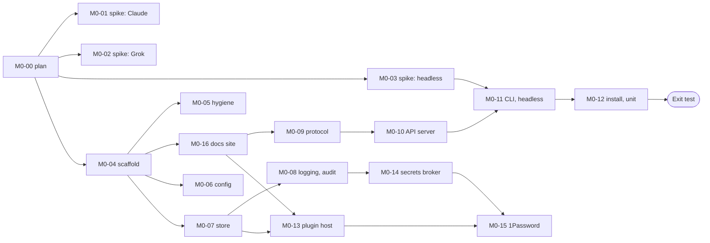

# M0 plan: Foundations

- Issue: [M0-00]
- Milestone: [M0 · Foundations](https://github.com/jcore9/Aphelion/milestone/1)
- Release: v0.1.0-alpha.1 ([decision 0003](../../decisions/0003-release-versioning.md))
- Status: Draft, waiting for review. Q1 and Q2 are answered ([0005](../../decisions/0005-bot-account-authors-prs.md), [0006](../../decisions/0006-shared-agent-user.md)); Q8 is obsolete.
- Last updated: 2026-11-21

M0 builds the ground everything else stands on: the repo, the docs, the config, the store, the protocol, the API server, the headless service, the plugin host and the secrets broker. It ships no agents. It also answers three questions, as written spikes, that decide how M1 and M4 run the AI CLIs at all.

## Exit criterion

The service starts on boot and answers `/health` from a client over Tailscale.

That test needs a real VM, a reboot and a tailnet, so CI can't run it. CI covers everything up to it (the server answers `/health`, unauthenticated sockets are rejected, the unit file passes `systemd-analyze verify`), and the full test is run by hand on a VM using the steps in [Exit test](#exit-test). Its output goes into the retro note.

## Scope

### In scope

| ID | Issue | Labels | Depends on |
| --- | --- | --- | --- |
| [M0-00] | Milestone plan (this document) | docs | none |
| [M0-01] | Spike: Claude over ACP on a subscription login | spike, server | M0-00 |
| [M0-02] | Spike: Grok headless billing | spike, server | M0-00 |
| [M0-03] | Spike: headless without Electron | spike, desktop | M0-00 |
| [M0-04] | Monorepo scaffold | chore | M0-00 |
| [M0-05] | Repo hygiene and MIT license | chore, security, **risk/security** | M0-04 |
| [M0-16] | Docs site and decision records | docs | M0-04 |
| [M0-06] | Config directory and schema | feature, server | M0-04 |
| [M0-07] | SQLite store and migrations | feature, server | M0-04 |
| [M0-08] | Structured logging and audit log | feature, server, security | M0-07 |
| [M0-09] | Protocol package v0 | feature, server, client | M0-04, M0-16 |
| [M0-10] | API server skeleton | feature, server, security, **risk/security** | M0-09 |
| [M0-11] | CLI and headless mode | feature, server, desktop | M0-03, M0-10 |
| [M0-12] | Linux install script and systemd unit | feature, server, security, **risk/security** | M0-11 |
| [M0-13] | Plugin host v0 | feature, plugins, **risk/security** | M0-04, M0-07, M0-16 |
| [M0-14] | Secrets broker v0 | feature, security, **risk/security** | M0-08 |
| [M0-15] | 1Password backend plugin | feature, plugins, security, **risk/security** | M0-13, M0-14 |

Six of the sixteen work issues carry `risk/security`, so their PRs get a full line-by-line review. The splits proposed below keep each of those PRs small enough to review that way.

### Out of scope

- Agents, adapters and sessions (M1). M0-01 and M0-02 only answer questions; they don't build adapters.
- Policy rules and approvals (M2). M0 builds the audit table that M2 writes to, not the policy engine.
- The gateway host (M3). The secrets broker is built so it can move there, but in M0 it runs on the same machine (see [Q4](#q4-where-the-secrets-broker-runs-before-the-gateway-exists)).
- Any client UI beyond `curl` and the test client in M1.
- Anything that looks like a coding app.

## Sequencing

| Wave | Starts when | Issues, all in parallel |
| --- | --- | --- |
| 1 | This plan is approved | M0-01, M0-02, M0-03, M0-04 |
| 2 | M0-04 merges | M0-05, M0-16, M0-06, M0-07 |
| 3 | Its dependencies merge | M0-08, M0-09, M0-13 |
| 4 | Its dependencies merge | M0-10, M0-14 |
| 5 | Its dependencies merge | M0-11, M0-15 |
| 6 | M0-11 merges | M0-12, then the exit test |

The critical path is M0-04, M0-16, M0-09, M0-10, M0-11, M0-12. M0-03 has to finish before M0-11 starts, so it runs in wave 1 even though nothing else waits on it.

M0-01 and M0-02 block nothing inside M0. They block [M1-02] and [M4-01], and their answers can change the shape of M1, M4 and M7, which is why they run first instead of at the start of M1.

## The three spikes

Each spike is a set of questions answered in writing before anything builds on them. A spike ends with a finding at `docs/spikes/M0-0N-<slug>.md` that answers every question below, cites its sources with the date they were checked, and states what changes downstream. Prototype code stays on the `spike/` branch and isn't merged. If a finding needs a decision, it becomes a decision record that the owner approves.

The spikes don't assume their answers. Where an answer is "no", or the terms are unclear, the spike stops and asks the owner instead of choosing a workaround.

### M0-01: Claude over ACP on a subscription login

Questions:

1. Which ACP adapters for Claude Code exist today (for example [claude-agent-acp](https://github.com/agentclientprotocol/claude-agent-acp)), at which versions, and how are they maintained?
2. For each candidate: with `ANTHROPIC_API_KEY` unset, on a fresh Unix user that has signed in to Claude Code with a Pro or Max account, does a full turn with a tool call complete? Does the usage show up against the subscription and not against API billing?
3. Do Anthropic's current terms allow a subscription login to be driven from a self-hosted harness for one person's own use? Quote the exact terms and their dates. If they're unclear, the spike says so and stops.
4. Does the adapter send a permission request for every tool call, and can it run without any bypass or always-approve mode? M2-04 depends on this.
5. Does ACP session resume work after the process restarts, and does it depend on the working directory? M1-04 depends on this.
6. Does the `-p --output-format stream-json --verbose --resume` path ([M1-03]) answer questions 2 and 4 the same way?

What changes depending on the answer:

| Finding | Consequence |
| --- | --- |
| ACP works on a subscription and the terms allow it | M1-02 goes ahead as planned. |
| Only stream-json works on a subscription | M1-03 becomes the primary path, and a decision record amends "ACP first" for Claude. |
| Neither works without an API key, or the terms don't allow it | Stop. The owner decides between API-key billing and changing scope. M7's Claude collector changes with it. |

### M0-02: Grok headless billing

Questions:

1. With no `XAI_API_KEY` set, on a fresh Unix user signed in with the owner's SuperGrok subscription, does `grok agent stdio` complete a turn with a tool call?
2. Does that turn draw from the shared weekly pool shown in Settings → Usage, or does it bill to an xAI API account at token rates?
3. Which subscription tiers include headless and ACP use?
4. Do xAI's current terms allow driving it from a self-hosted harness? Quote them with dates, and stop if they're unclear.
5. In stdio mode, are permission requests sent over ACP for every tool call, and do `auto_update = false` and a root-owned `/etc/grok/requirements.toml` still apply? M2-05 depends on this.

What changes depending on the answer:

| Finding | Consequence |
| --- | --- |
| Works on the subscription and the terms allow it | M4-01 goes ahead as planned. |
| Needs an API key | Stop. The owner decides whether Grok runs on API billing in v1. M7-03 changes from estimating a pool to reading API usage. |
| Terms don't allow it | Stop. The owner decides whether Grok stays in v1. |

### M0-03: headless without Electron

The acceptance criterion asks for a prototype where one install exposes `aphelion --headless` and runs on a server VM with no GUI libraries.

Questions:

1. What does "one install" mean in practice? Candidates to test: one `.deb` that contains both the server and the desktop app, with the GUI libraries as optional (`Recommends`) dependencies; a server package that the desktop package depends on; an npm global install with Electron as an optional dependency.
2. Which Node runtime does headless mode run on: the system's Node LTS, a Node bundled with Aphelion, or Electron's own Node through `ELECTRON_RUN_AS_NODE`? The last one still starts the Electron binary, which links GUI libraries, so the spike checks whether that rules it out.
3. On a minimal server image of each target distro ([Q3](#q3-which-linux-distros-v1-supports)) with no X11, Wayland, GTK or NSS libraries, does `aphelion --headless` start and answer a stub `/health`? Show what's loaded (for example with `ldd` and `/proc/<pid>/maps`).
4. How do the systemd unit and the upgrade path look for that shape, for both the headless and the desktop install?

If no shape gives both "one install" and "no GUI libraries", the spike says so and the owner picks which one gives.

M0-04 lays out the `cli` package without committing to a packaging shape, so M0-03's answer doesn't force a rework.

## Design notes

These are starting points for each issue's PR, not final designs. Where an issue has to choose a tool or library, its PR includes a decision record that weighs the options, and the owner approves it with the PR. Expected records are marked **DR**.

**M0-04, monorepo scaffold.** Packages are `@aphelion/server`, `client`, `protocol`, `plugin-sdk` and `cli`, plus a `docs` workspace that M0-16 fills in. Node is pinned to the current Active LTS through `engines` and `.nvmrc`, and pnpm through the `packageManager` field. CI runs lint, typecheck and test on every PR into `dev`. **DR:** linter (ESLint with typescript-eslint, or Biome), keeping in mind that M5-02 needs a token lint rule later. This issue touches every package by nature, which is the one accepted exception to the "one package per issue" size rule.

**M0-05, repo hygiene.** SECURITY.md points to GitHub's private vulnerability reporting, which is a repo setting that has to be switched on. CODEOWNERS covers the security-sensitive paths named in the workflow, including paths that don't exist yet, so they're protected from their first commit. The label set already exists ([decision 0002](../../decisions/0002-type-docs-label.md)); CONTRIBUTING documents it. Branch protection is a repo setting, not part of the diff. It requires an approving review and blocks direct pushes to `dev` and `main`, so the bot account from [decision 0005](../../decisions/0005-bot-account-authors-prs.md) can only push its own branches. M0-05 (b) goes early in wave 2, because until it lands nothing technically stops the bot from pushing to `dev`.

**M0-16, docs site.** Starlight in the `docs` workspace, built in CI with a link check (for example the `starlight-links-validator` plugin). It moves this plan, the imported [plan](../aphelion-plan.md) and decision records 0001 to 0004 into the site, adds the decision-record template in the same format as those records, and writes up the plan's existing decisions from 0005 on. It also adds the M1-00 to M9-00 rows to the plan's Issue breakdown ([decision 0001](../../decisions/0001-planning-issue-per-milestone.md)).

**M0-06, config directory.** One versioned directory for agents, policy, routines and connectors, which can be a git repo. Each file carries a `version` field, and a migration moves it forward. Agents can never write to it; its location and owner depend on [Q6](#q6-where-the-config-directory-lives). **DR:** the schema library, which needs to export JSON Schema so the docs and editors can use it.

**M0-07, SQLite store.** WAL mode, forward-only numbered migrations, and a migration test in CI. The database file is owned by the harness user with mode 0600. **DR:** the driver (Node's built-in `node:sqlite` or `better-sqlite3`).

**M0-08, logging and audit log.** Structured JSON logs, redacted by field name and by value pattern. M0-14 adds the `Secret` type, which redacts itself, and extends the redaction test to cover it, because M0-08 lands before that type exists. The audit table is append-only, enforced by SQLite triggers that reject `UPDATE` and `DELETE`. **DR:** the logging library.

**M0-09, protocol v0.** Every frame carries `v: 1`. The server assigns increasing sequence numbers to events; a client reconnects with its last sequence number and gets what it missed. If its cursor is older than what the server kept, the server tells it to resync instead of replaying a partial history. Commands carry a client-generated id, and a retried id is applied once. M0 defines the frame envelope and the types it needs; later milestones add their own commands and events. **DR:** how the spec is generated from the TypeScript types.

**M0-10, API server.** It binds only to the configured address and refuses a wildcard address such as `0.0.0.0`, since the server is meant to be reachable only over the tailnet. `/health` needs no token and returns only `{"status":"ok"}`, without a version or other details, to keep the attack surface small. Device tokens are issued on the host (`aphelion device add <name>` prints the token once), stored hashed, expire, and can be revoked. Any WebSocket without a valid token is closed. Tailscale device identity depends on [Q5](#q5-tailscale-device-identity-in-m0).

**M0-11, CLI.** `aphelion --headless`, `aphelion --version` and `aphelion config check`, shaped by M0-03's finding. Headless mode never loads Electron.

**M0-12, install script and unit.** The script runs as root once. It creates two system users, `harness` and `aphelion-agent`, neither with sudo rights. It sets directory ownership and modes so `aphelion-agent` can't read or write the config, the database or the managed hooks, and it installs a hardened unit for the harness (`NoNewPrivileges`, `ProtectSystem=strict`, `ProtectHome`, `PrivateTmp`, no capabilities). It also installs the `aphelion-agent@.service` template and the polkit rule that lets `harness` start and stop only those units ([decision 0006](../../decisions/0006-shared-agent-user.md)); M1-04 is the first to use them. The issue's "without sudo" means the users get no sudo rights; the script itself needs root. The install guide ships in the same PR.

**M0-13, plugin host v0.** One process per plugin, JSON-RPC over stdio, a manifest schema in `plugin-sdk`, an API-range check, and permission grants stored in SQLite and enforced by the host, which only forwards the events and APIs a plugin was granted. Each plugin still runs as its own Unix user, started through systemd the same way as agents ([decision 0006](../../decisions/0006-shared-agent-user.md)). **DR:** the API reference generator.

**M0-14, secrets broker v0.** The `Secret` wrapper, the reference syntax (`op://`, `bws://`, `local://`), a local store encrypted with the `age-encryption` package, and the bootstrap secret loaded with `LoadCredentialEncrypted=`. The test uses a canary secret value and checks that it never appears in the logs or anywhere in the database file. Where it runs is [Q4](#q4-where-the-secrets-broker-runs-before-the-gateway-exists).

**M0-15, 1Password backend.** A plugin that resolves `op://` references through the official SDK with a read-only service account limited to one vault. The service account token is the bootstrap secret from M0-14. CI testing depends on [Q7](#q7-a-live-1password-test-in-ci).

## Proposed splits

The workflow says an issue a coding tool can't finish in one focused session, or that touches more than one package, gets split during milestone planning. These five are too large for one PR. Once this plan is approved, each one becomes sub-issues under the original issue, and the original closes when its sub-issues do.

| Issue | Split into | Why |
| --- | --- | --- |
| [M0-05] | (a) LICENSE, README, CONTRIBUTING, SECURITY.md, issue and PR templates. (b) CODEOWNERS and branch protection on `main` and `dev`, **risk/security**. | (b) changes who can merge, so it gets its own review. |
| [M0-09] | (a) Frame and message types, sequence numbers, replay and idempotent ids, with the replay test. (b) Spec generated into the docs. | (b) touches the docs workspace and build tooling. |
| [M0-10] | (a) HTTP and WebSocket server bound to the configured address, and `/health`. (b) Per-device tokens and rejecting unauthenticated sockets, **risk/security**. | Auth gets its own line-by-line review. |
| [M0-13] | (a) Manifest schema and API-range check in `plugin-sdk`, with the out-of-range refusal. (b) Process-per-plugin JSON-RPC host and the sample plugin. (c) Permission grants stored and enforced, **risk/security**. (d) API reference generated into the docs. | Four concerns across three packages. |
| [M0-14] | (a) `Secret` wrapper, reference syntax and the "never in logs or the database" test. (b) Local age-encrypted store. (c) Bootstrap secret through `systemd-creds`. | Three separate security-sensitive pieces. |

M0-12 stays whole: the script, the unit and the install guide only make sense together, and the PR is still well under the size limit.

## Risks

| Risk | Effect | Mitigation |
| --- | --- | --- |
| A spike finds that a subscription path doesn't work, or that the terms don't allow it | M1, M4 and M7 change shape | Spikes run first; a "no" or an unclear answer stops for the owner. |
| The bot account has the Write role before branch protection exists | It could push to `dev` or `main` directly | M0-05 (b) goes early in wave 2 ([decision 0005](../../decisions/0005-bot-account-authors-prs.md)). |
| All agents share one Unix user | A prompt-injected agent can read or damage other agents' workspaces | Accepted by design ([decision 0006](../../decisions/0006-shared-agent-user.md)). Snapshots, backups and git are the recovery path, and the threat model says so. |
| "One install" and "no GUI libraries" turn out to conflict | M0-11 and M5-15 packaging | M0-03 answers it before M0-11 starts. |
| M0-16 moves docs into the Starlight content folder | The plan links in every issue body break | M0-16 keeps `docs/plan/aphelion-plan.md` resolving, or updates the issue bodies in the same PR. |
| The exit test needs a real VM, a reboot and Tailscale | CI can't prove the exit criterion | CI covers the parts it can; the rest is the scripted manual run below. |
| The spikes need real Claude Pro or Max and SuperGrok logins on a VM | Wave 1 can't start without them | Listed under [What I need from you](#what-i-need-from-you). |
| Six security-sensitive issues in one milestone | Heavy review load | The splits above keep each of those PRs small. |

## Open questions

Each question has a recommended answer. The answers go into decision records, numbered from 0005 in the order they're settled (M0-16 continues after them).

### Q1. How you approve PRs that come from your own account

**Answered in [decision 0005](../../decisions/0005-bot-account-authors-prs.md):** agent PRs are authored by the `jcore9-bot` account with the Write role, and you approve them from your own account.

### Q2. How the harness starts processes as other Unix users

**Answered in [decision 0006](../../decisions/0006-shared-agent-user.md):** all agents share one `aphelion-agent` user and can read and write each other's workspaces, while the harness, config and approval layer stay out of their reach. systemd starts each agent in its own unit, so the harness never needs root. Manager agents change other agents' definitions only through built-in tools that go through approvals.

### Q3. Which Linux distros v1 supports

The install script, the spikes and the exit test need a target.

- **Recommended:** current Debian stable and the current Ubuntu LTS, on systemd 250 or later (the first version with `systemd-creds` encrypted credentials bound to a TPM).

Blocks: M0-03, M0-12.

### Q4. Where the secrets broker runs before the gateway exists

The plan puts the broker on the gateway host, which arrives in M3-01.

- **Recommended:** M0 builds the broker as its own process from the start, under its own Unix user, reached over a local socket that only the harness can open. M3-01 then moves the process to the gateway host without changing its API.
- Alternative: a library inside the harness for now, made into a separate process in M3.

Blocks: M0-14.

### Q5. Tailscale device identity in M0

The plan wants device identity from Tailscale plus a per-device token. Asking Tailscale who a peer is (its `whois` lookup) may need access to the local Tailscale socket that the harness user doesn't have by default, and granting operator rights would give the harness more control over Tailscale than it needs.

- **Recommended:** M0-10 (b) checks whether the harness can do the lookup without operator rights. If it can, it ships in M0. If it can't, M0 ships token-only plus binding to the tailnet address, and the identity check gets its own issue in M5.

Blocks: M0-10 (b).

### Q6. Where the config directory lives

The harness must be able to write it, because the web client edits the policy file, and agents must not be able to read or write it.

- **Recommended:** `/etc/aphelion/`, owned by the `harness` user with mode 0750, and the database and state under `/var/lib/aphelion/`. Both paths can be overridden for development.

Blocks: M0-06, M0-12.

### Q7. A live 1Password test in CI

- **Recommended:** CI tests the backend against a mocked SDK. A live test against a real vault runs by hand, and its output goes into the PR. A live test in CI would need a service-account token stored as a GitHub Actions secret, which adds a credential outside the gateway.

Blocks: M0-15.

### Q8. How agent users are added after install

**Obsolete:** with one shared agent user ([decision 0006](../../decisions/0006-shared-agent-user.md)), a new agent needs no new Unix user.

## What I need from you

1. A review of this plan, including the proposed splits and answers to Q3 to Q7.
2. For M0-01 and M0-02: a Linux VM where you sign in to Claude Code with your Pro or Max account and to Grok Build with your SuperGrok account, on a fresh Unix user. The sign-ins are yours to do; the spikes don't need your credentials passed to them.
3. For the exit test: a VM on your tailnet that the install script can be run on.

## Exit test

Run on a fresh VM of each target distro:

1. Run the install script as root.
2. Check that `systemctl is-enabled aphelion` reports `enabled`, then reboot.
3. From another device on the tailnet, `curl http://<tailnet-address>:<port>/health` returns `200` with `{"status":"ok"}`.
4. A WebSocket opened without a token is closed; one opened with a token from `aphelion device add` is accepted.
5. `sudo -l -U aphelion-agent` and `sudo -l -U harness` show no sudo rights, and `aphelion-agent` can't read or write the config directory, the database or the unit files.
6. The output of each step goes into the retro note.

## Docs M0 produces

| Doc | Issues |
| --- | --- |
| README | M0-05 |
| CONTRIBUTING, SECURITY.md, issue and PR templates | M0-05 |
| Decision records and template | This PR (0001 to 0004), M0-16, and each DR above |
| Docs site and the plan in `docs/plan` | This PR, M0-16 |
| Spike findings | M0-01, M0-02, M0-03 |
| Config reference | M0-06 |
| Protocol spec (generated) | M0-09 |
| Plugin API reference (generated) | M0-13 |
| Install guide for the headless server | M0-12 |
| Security and threat model (first draft: users, shared agent workspaces, secrets, bind address) | M0-12, M0-14 |
| Architecture overview, kept current | Every PR that changes it |
| Changelog | The M0 release PR |

## Retro

Written when M0 closes.

[M0-00]: https://github.com/jcore9/Aphelion/issues/1
[M0-01]: https://github.com/jcore9/Aphelion/issues/2
[M0-02]: https://github.com/jcore9/Aphelion/issues/3
[M0-03]: https://github.com/jcore9/Aphelion/issues/4
[M0-04]: https://github.com/jcore9/Aphelion/issues/5
[M0-05]: https://github.com/jcore9/Aphelion/issues/6
[M0-16]: https://github.com/jcore9/Aphelion/issues/7
[M0-06]: https://github.com/jcore9/Aphelion/issues/8
[M0-07]: https://github.com/jcore9/Aphelion/issues/9
[M0-08]: https://github.com/jcore9/Aphelion/issues/10
[M0-09]: https://github.com/jcore9/Aphelion/issues/11
[M0-10]: https://github.com/jcore9/Aphelion/issues/12
[M0-11]: https://github.com/jcore9/Aphelion/issues/13
[M0-12]: https://github.com/jcore9/Aphelion/issues/14
[M0-13]: https://github.com/jcore9/Aphelion/issues/15
[M0-14]: https://github.com/jcore9/Aphelion/issues/16
[M0-15]: https://github.com/jcore9/Aphelion/issues/17
[M1-02]: https://github.com/jcore9/Aphelion/issues/20
[M1-03]: https://github.com/jcore9/Aphelion/issues/21
[M4-01]: https://github.com/jcore9/Aphelion/issues/44
