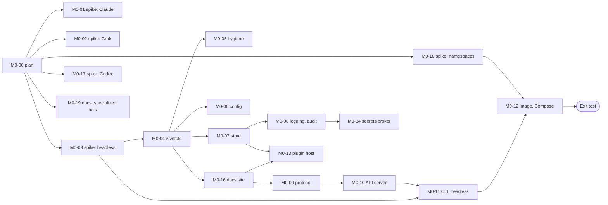

# M0 plan: Foundations

- Issue: [M0-00]
- Milestone: [M0 · Foundations](https://github.com/jcore9/Aphelion/milestone/1)
- Release: v0.1.0-alpha.1 ([decision 0003](../../decisions/0003-release-versioning.md))
- Status: Approved and merged in [#92](https://github.com/jcore9/Aphelion/pull/92) on 2026-11-21. Decisions 0005 to 0018 settle every open question. In progress.
- Last updated: 2026-11-21

M0 builds the ground everything else stands on: the repo, the docs, the config, the store, the protocol, the API server, the headless service, the plugin host and the secrets broker. It ships no bots. It also answers five questions, as written spikes, that decide how M1 and M4 run the AI CLIs at all.

## Exit criterion

The service starts on boot and answers `/health` from a client over Tailscale.

That test needs a real VM, a reboot and a tailnet, so CI can't run it. CI covers everything up to it (the server answers `/health`, unauthenticated sockets are rejected, the image builds, the Compose file validates, and inside the container `aphelion-bot` can't read the server's or the broker's files), and the full test is run by hand on a VM using the steps in [Exit test](#exit-test). Its output goes into the retro note.

## Scope

### In scope

| ID | Issue | Labels | Depends on |
| --- | --- | --- | --- |
| [M0-00] | Milestone plan (this document) | docs | none |
| [M0-01] | Spike: Claude over ACP on a subscription login | spike, server | M0-00 |
| [M0-02] | Spike: Grok headless billing | spike, server | M0-00 |
| [M0-03] | Spike: headless without Electron | spike, desktop | M0-00 |
| [M0-17] | Spike: Codex headless on a ChatGPT login | spike, server | M0-00 |
| [M0-18] | Spike: per-bot isolation with user namespaces | spike, security, **risk/security** | M0-00 |
| [M0-19] | Write down the specialized-bot model ([decision 0058](../../decisions/0058-specialized-bots.md)) | docs, plugins | M0-00 |
| [M0-04] | Monorepo scaffold | chore | M0-03 |
| [M0-05] | Repo hygiene and MIT license | chore, security, **risk/security** | M0-04 |
| [M0-16] | Docs site and decision records | docs | M0-04 |
| [M0-06] | Config directory and schema | feature, server | M0-04 |
| [M0-07] | SQLite store and migrations | feature, server | M0-04 |
| [M0-08] | Structured logging and audit log | feature, server, security | M0-07 |
| [M0-09] | Protocol package v0 | feature, server, client | M0-04, M0-16 |
| [M0-10] | API server skeleton | feature, server, security, **risk/security** | M0-09 |
| [M0-11] | CLI and headless mode | feature, server, desktop | M0-03, M0-10 |
| [M0-12] | Container image, Compose file and host unit | feature, server, security, **risk/security** | M0-11, M0-18 |
| [M0-13] | Plugin host v0 | feature, plugins, **risk/security** | M0-04, M0-07, M0-16 |
| [M0-14] | Secrets broker v0 | feature, security, **risk/security** | M0-08 |
| [M0-15] | ~~1Password backend plugin~~ Moved to M3 ([decision 0053](../../decisions/0053-1password-token-and-move-to-m3.md)) | feature, plugins, security, **risk/security** | M0-13, M0-14 |

~~Seven of the eighteen~~ ~~Six of the seventeen~~ Six of the eighteen work issues ([decision 0053](../../decisions/0053-1password-token-and-move-to-m3.md), [decision 0058](../../decisions/0058-specialized-bots.md)) carry `risk/security`, so their PRs get a full line-by-line review. The splits proposed below keep each of those PRs small enough to review that way.

### Out of scope

- Bots, adapters and sessions (M1). M0-01, M0-02, M0-17 and M0-18 only answer questions; they don't build adapters.
- Policy rules and approvals (M2). M0 builds the audit table that M2 writes to, not the policy engine.
- The gateway host (M3). The secrets broker is built so it can move there, but in M0 it runs on the same machine (see [Q4](#q4-where-the-secrets-broker-runs-before-the-gateway-exists)).
- Any client UI beyond `curl` and the test client in M1.
- Anything that looks like a coding app.

## Sequencing

| Wave | Starts when | Issues, all in parallel |
| --- | --- | --- |
| 1 | This plan is approved | M0-01, M0-02, M0-03, M0-17, M0-18, M0-19 |
| 2 | M0-03's finding is approved | M0-04 |
| 3 | M0-04 merges | M0-05, M0-16, M0-06, M0-07 |
| 4 | Its dependencies merge | M0-08, M0-09, M0-13 |
| 5 | Its dependencies merge | M0-10, M0-14 |
| 6 | Its dependencies merge | M0-11, ~~M0-15~~ |
| 7 | M0-11 and M0-18 merge | M0-12, then the exit test |

> Amended by [decision 0053](../../decisions/0053-1password-token-and-move-to-m3.md). M0-15 moved to M3, so the graph no longer shows it and wave 6 holds only M0-11.

The critical path is M0-03, M0-04, M0-16, M0-09, M0-10, M0-11, M0-12. M0-04 waits for M0-03 because the spike checks that Bun runs the SDKs the project depends on ([decision 0007](../../decisions/0007-bun-runtime.md)) before the scaffold commits to it.

M0-01 and M0-02 block nothing inside M0. They block [M1-02] and [M4-01], and their answers can change the shape of M1, M4 and M7, which is why they run first instead of at the start of M1.

M0-17 blocks nothing inside M0 either. It blocks [M4-10], the Codex adapter ([decision 0024](../../decisions/0024-codex-third-bot-cli.md)).

M0-18 was added on 2026-11-22 by [decision 0035](../../decisions/0035-codex-login-sandbox-approvals.md). It depends only on M0-00, so it belongs to wave 1 and can start now. It blocks [M0-12], the container image, because the image's seccomp profile (the list of system calls the container may make) and its host setup depend on what the spike finds. It also blocks [M1-04], the session manager, because the answer decides how each bot is started. An unfinished M0-18 can therefore delay the exit test.

M0-19 was added on 2026-11-23, when the owner asked for specialized bots, each with its own connectors and plugins. It is docs only, depends only on M0-00, and blocks nothing inside M0. It writes the model down before M1 builds bots. [Decision 0058](../../decisions/0058-specialized-bots.md) records the owner's answers, and M3-06, M4-02 and M5-13 carry the work.

M0-18 is settled. The owner answered its questions on 2026-11-22, and [decision 0045](../../decisions/0045-no-bot-namespaces-default-seccomp.md) records the answers: bots get no namespaces of their own, the container keeps Docker's default seccomp profile, and Codex runs without its own sandbox. No seccomp profile ships, so M0-12 and [M4-10] have none to carry. How [M1-04] cancels a bot is still open, because a process group misses processes that leave it. Decision 0045 lists the options.

## The spikes

Each spike is a set of questions answered in writing before anything builds on them. A spike ends with a finding at `docs/spikes/M0-NN-<slug>.md` that answers every question below, cites its sources with the date they were checked, and states what changes downstream. Prototype code stays on the `spike/` branch and isn't merged. If a finding needs a decision, it becomes a decision record that the owner approves.

The spikes don't assume their answers. Where an answer is "no", or the terms are unclear, the spike stops and asks the owner instead of choosing a workaround.

### M0-01: Claude over ACP on a subscription login

Questions:

1. Which ACP adapters for Claude Code exist today (for example [claude-agent-acp](https://github.com/agentclientprotocol/claude-agent-acp)), at which versions, and how are they maintained?
2. For each candidate: with `ANTHROPIC_API_KEY` unset, on a fresh Unix user that has signed in to Claude Code with a Pro or Max account, does a full turn with a tool call complete? Does the usage show up against the subscription and not against API billing?
3. Do Anthropic's current terms allow a subscription login to be driven from a self-hosted harness for one person's own use? Quote the exact terms and their dates. If they're unclear, the spike says so and stops.
4. Does the adapter send a permission request for every tool call, and can it run without any bypass or always-approve mode? M2-04 depends on this.
5. Does ACP session resume work after the process restarts, and does it depend on the working directory? M1-04 depends on this.
6. Does the `-p --output-format stream-json --verbose --resume` path ([M1-03]) answer questions 2 and 4 the same way?

What changes depending on the answer:

| Finding | Consequence |
| --- | --- |
| ACP works on a subscription and the terms allow it | M1-02 goes ahead as planned. |
| Only stream-json works on a subscription | M1-03 becomes the primary path, and a decision record amends "ACP first" for Claude. |
| Neither works without an API key, or the terms don't allow it | Stop. The owner decides between API-key billing and changing scope. M7's Claude collector changes with it. |

### M0-02: Grok headless billing

Questions:

1. With no `XAI_API_KEY` set, on a fresh Unix user signed in with the owner's SuperGrok subscription, does `grok agent stdio` complete a turn with a tool call?
2. Does that turn draw from the shared weekly pool shown in Settings → Usage, or does it bill to an xAI API account at token rates?
3. Which subscription tiers include headless and ACP use?
4. Do xAI's current terms allow driving it from a self-hosted harness? Quote them with dates, and stop if they're unclear.
5. In stdio mode, are permission requests sent over ACP for every tool call, and do `auto_update = false` and a root-owned `/etc/grok/requirements.toml` still apply? M2-05 depends on this.

What changes depending on the answer:

| Finding | Consequence |
| --- | --- |
| Works on the subscription and the terms allow it | M4-01 goes ahead as planned. |
| Needs an API key | Stop. The owner decides whether Grok runs on API billing in v1. M7-03 changes from estimating a pool to reading API usage. |
| Terms don't allow it | Stop. The owner decides whether Grok stays in v1. |

### M0-03: headless without Electron, on Bun

Decisions [0007](../../decisions/0007-bun-runtime.md), [0009](../../decisions/0009-electron-desktop-shell.md) and [0016](../../decisions/0016-one-docker-container.md) settle the shape. The server is one Bun binary built with `bun build --compile`. The server ships only as a Docker image that runs that binary. The desktop app is a client that connects to it and never runs a server ([decision 0017](../../decisions/0017-desktop-remote-only.md)). The original question, "no GUI libraries on a server", is answered by the image, so the spike checks that the shape holds and that Bun runs everything the project depends on.

Questions:

1. Does the compiled binary run inside an Ubuntu LTS image with no X11, Wayland, GTK or NSS libraries, under the Compose hardening from decision 0016 (read-only root filesystem, `cap_drop: ALL` plus the minimum added back, `no-new-privileges`), and answer a stub `/health` on a port published only on a tailnet address?
2. Can a minimal init start four processes as four different users with only `SETUID` and `SETGID` added back? Which init tool fits (for example tini plus a small launcher, or s6-overlay), and does it shut them down cleanly?
3. Does each dependency work on Bun, with a minimal call that proves it: the MCP TypeScript SDK (stdio and Streamable HTTP), the ACP TypeScript SDK, the Claude ACP adapter, `@1password/sdk`, `@bitwarden/sdk-napi` and `age-encryption`? Do they still work inside a `--compile` binary?
4. How do Vitest tests reach the Bun-only adapter modules: Vitest running under Bun's runtime, or `bun test` for those modules only?
5. How does a host `aphelion.service` start the Compose project on boot and pass it the bootstrap secret from `LoadCredentialEncrypted=` as a Compose secret?

If a dependency fails on Bun, or the hardening can't hold with three users in one container, the spike says so and the owner decides.

### M0-17: Codex headless on a ChatGPT login

[Decision 0024](../../decisions/0024-codex-third-bot-cli.md) makes OpenAI's Codex CLI a third bot CLI, on the owner's own ChatGPT login. The adapter is built later, in [M4-10]. This spike answers first whether Codex can run here at all. The issue lists what was found on 2026-11-21 under each question, as a starting point.

The answers are in the [M0-17 finding](../../spikes/M0-17-codex-headless.md).

Questions:

1. Which headless or ACP path exists today, at which version: [`@agentclientprotocol/codex-acp`](https://github.com/agentclientprotocol/codex-acp), `codex app-server`, `codex exec --json` or `codex mcp-server`? Does the chosen path run on Bun?
2. With `OPENAI_API_KEY` and `CODEX_API_KEY` unset, on a fresh Unix user signed in with a ChatGPT plan, does a turn with a tool call complete? Does the usage count against the plan and not against API billing?
3. Which ChatGPT plans include the CLI and app-server?
4. Do OpenAI's current terms allow driving it from a self-hosted harness for one person's own use? Quote them with dates, and stop if they're unclear.
5. Can Codex send a permission request for every tool call, with no bypass, `never`, full-access or Auto-review mode? With the `on-request` policy, commands that the sandbox allows run without asking. M2-04 depends on this.
6. Can a root-owned `/etc/codex/requirements.toml` pin the approval policy, the sandbox, the login method and a managed hook that fails closed, and can auto-update be turned off? M2-05 depends on this.
7. Does it run as `aphelion-bot` in the hardened container, with egress only through `HTTPS_PROXY` and `NO_PROXY` ([decision 0022](../../decisions/0022-bot-network-boundary.md))? Does Codex's own sandbox start there, and which hosts does Codex need?
8. Does session resume work after a restart, and does the stream report how much of the subscription's usage allowance is used, for M7?

What changes depending on the answer:

| Finding | Consequence |
| --- | --- |
| `codex-acp` works on a ChatGPT login, every tool call can be made to ask, and the terms allow it | M4-10 goes ahead on `codex-acp`. |
| `codex-acp` falls short but `codex app-server` works | M4-10 speaks app-server JSON-RPC directly, and a decision record amends "ACP first" for Codex. |
| Only `codex exec --json` works | Stop. `exec` can't answer approvals mid-turn, so the owner decides whether Codex stays in scope. |
| Not every tool call can be made to ask, or root-owned config can't block the bypass modes | Stop. The owner decides between a sandbox-based policy for Codex and leaving Codex out. |
| It needs an API key, or the owner's plan doesn't include the CLI | Stop. The owner decides between API billing for Codex and leaving Codex out. |
| The terms don't allow it, or are unclear | Stop. The owner decides, and decision 0024 is revisited. |
| Codex's own sandbox can't start in the container | The finding says whether to run Codex with its sandbox off, with the container as the boundary and approvals still on. If that changes the security model, it becomes a decision record. |

### M0-18: per-bot isolation with user namespaces

[Decision 0035](../../decisions/0035-codex-login-sandbox-approvals.md) planned to let the container create user namespaces ([decision 0045](../../decisions/0045-no-bot-namespaces-default-seccomp.md) reversed that). A user namespace is a Linux feature that changes how the kernel treats user IDs and privileges: a process can look like root inside it and stay an ordinary user outside. Codex's sandbox needs one. Other kinds of namespace give a process a private view of the file system (mount namespace) or of the process list (PID namespace). Isolating a bot would combine these. The owner asked whether the same feature could isolate each bot from the others, in place of one Unix user per bot ([decision 0006](../../decisions/0006-shared-bot-user.md)). The full question list is in [issue #124][M0-18]. The answers are in the [M0-18 finding](../../spikes/M0-18-namespaces.md). The owner's choices are in [decision 0045](../../decisions/0045-no-bot-namespaces-default-seccomp.md): the isolation works, but the owner declined it, and the plan stays with shared bots and Docker's default seccomp profile.

Questions:

1. Can the bot runner start each bot in its own user and mount namespace, inside the hardened container from [decision 0016](../../decisions/0016-one-docker-container.md)?
2. Do Claude Code, Grok Build and Codex run in such a namespace, with their logins and egress only through `HTTPS_PROXY` and `NO_PROXY`? Does Codex's own sandbox still start inside it?
3. Does AppArmor on Ubuntu 26.04 block it, and is the fix scoped to the container or to the whole host?
4. What does the seccomp profile add to Docker's default, and what kernel attack surface comes with it?
5. Could namespaces end the shared-folder risk that decision 0006 accepted, without one Unix user per bot?
6. Do the "ready for option 2" rules from [decision 0022](../../decisions/0022-bot-network-boundary.md) still hold, including cancel and kill reaching the bot's whole process tree?

What changes depending on the answer:

| Finding | Consequence |
| --- | --- |
| Per-bot isolation works for all three CLIs, and the profile adds only what `bwrap` needs | The owner is asked in a new decision record, which amends 0006 once approved. Only then does M1-04 start bots in their own namespaces. M0-12 ships the profile and any AppArmor change, in place of M4-10. |
| Codex's sandbox starts, but isolation fails for some CLI | 0006 stands. The profile serves Codex only, and the finding names the CLI that fails. |
| Codex's sandbox fails inside a bot's namespace | The finding says whether the namespace can stand in for Codex's sandbox. A change to decision 0035 becomes a decision record. |
| The profile needs more than the namespace and mount calls | Stop. The owner decides whether decision 0035's profile stands. |
| AppArmor blocks it, and only a host-wide change fixes it | Stop. The owner decides whether the install guide makes that change. |
| It breaks a "ready for option 2" rule | The finding proposes a runner design that keeps the rule, or the owner decides. |

## Design notes

These are starting points for each issue's PR, not final designs. Where an issue has to choose a tool or library, its PR includes a decision record that weighs the options, and the owner approves it with the PR. Expected records are marked **DR**.

**M0-04, monorepo scaffold.** Bun workspaces with packages `@aphelion/server`, `client`, `protocol`, `plugin-sdk` and `cli`, plus a `docs` workspace that M0-16 fills in ([decision 0007](../../decisions/0007-bun-runtime.md)). The Bun version is pinned in the repo and in CI, and `bun.lock` is committed. Tests run on Vitest, in the way M0-03 settles. A lint rule allows `bun:` imports and the `Bun` global only in designated adapter modules. `protocol` and `plugin-sdk` use only web-standard APIs, so they run in Bun, Node and the browser. CI runs lint, typecheck and test on every PR into `dev`. **DR:** linter (ESLint with typescript-eslint, or Biome), keeping in mind that M5-02 needs a token lint rule later. Settled in [decision 0023](../../decisions/0023-scaffold-toolchain.md). This issue touches every package by nature, which is the one accepted exception to the "one package per issue" size rule.

> Amended by [decision 0047](../../decisions/0047-repo-layout.md). The workspaces are now `apps/server` (`@aphelion/server`, which holds the CLI too), `packages/protocol`, `packages/plugin-sdk`, `packages/ui` (`@aphelion/ui`, formerly `client`) and `docs`. `apps/desktop` and `apps/mobile` wait for M5 and M9.

**M0-05, repo hygiene.** SECURITY.md points to GitHub's private vulnerability reporting, which is a repo setting that has to be switched on. CODEOWNERS covers the security-sensitive paths named in the workflow, including paths that don't exist yet, so they're protected from their first commit. The label set already exists ([decision 0002](../../decisions/0002-type-docs-label.md)); CONTRIBUTING documents it. Branch protection is a pair of GitHub rulesets in `.github/rulesets/`, which the owner applies because the bot can't change settings. They require the owner's approval and block direct pushes to `dev` and `main`, so the bot account from [decision 0005](../../decisions/0005-bot-account-authors-prs.md) can only push its own branches. [Branch protection](../../branch-protection.md) explains each rule. M0-05 (b) goes first in wave 3, because until it lands nothing technically stops the bot from pushing to `dev`.

**M0-16, docs site.** Starlight in the `docs` workspace, built in CI with a link check (for example the `starlight-links-validator` plugin). It moves this plan, the imported [plan](../aphelion-plan.md) and the decision records into the site, adds the decision-record template in the same format as those records, and writes up the plan's remaining decisions, numbered after the records that already exist. It updates the plan text that decisions 0006 to 0009 amend. It also adds the M1-00 to M9-00 rows to the plan's Issue breakdown ([decision 0001](../../decisions/0001-planning-issue-per-milestone.md)).

**M0-06, config directory.** One versioned directory for bots, policy, routines and connectors, which can be a git repo. Each file carries a `version` field, and a migration moves it forward. Bots can never write to it; its location and owner depend on [Q6](#q6-where-the-config-directory-lives). **DR:** the schema library, which needs to export JSON Schema so the docs and editors can use it.

**M0-07, SQLite store.** WAL mode, forward-only numbered migrations, and a migration test in CI. The database file is owned by the harness user with mode 0600. **DR:** the driver: `bun:sqlite` inside the store adapter, or a portable driver. Either way it sits behind the store interface ([decision 0007](../../decisions/0007-bun-runtime.md)).

**M0-08, logging and audit log.** Structured JSON logs, redacted by field name and by value pattern. M0-14 adds the `Secret` type, which redacts itself, and extends the redaction test to cover it, because M0-08 lands before that type exists. The audit table is append-only, enforced by SQLite triggers that reject `UPDATE` and `DELETE`. **DR:** the logging library.

**M0-09, protocol v0.** Every frame carries `v: 1`. The server assigns increasing sequence numbers to events; a client reconnects with its last sequence number and gets what it missed. If its cursor is older than what the server kept, the server tells it to resync instead of replaying a partial history. Commands carry a client-generated id, and a retried id is applied once. M0 defines the frame envelope and the types it needs; later milestones add their own commands and events. **DR:** how the spec is generated from the TypeScript types.

**M0-10, API server.** It binds to the address in its config. In the container that's the container's own interface, and the Compose file publishes the port only on the host's tailnet address; `aphelion config check` refuses a Compose file that publishes it anywhere else ([decision 0016](../../decisions/0016-one-docker-container.md)). `/health` needs no token and returns only `{"status":"ok"}`, without a version or other details, to keep the attack surface small. Device tokens are issued with `aphelion device add <name>` (run through `docker compose exec`), which prints the token once. They're stored hashed, expire, and can be revoked. Any WebSocket without a valid token is closed. The container doesn't get the host's Tailscale socket, so Tailscale identity is likely to move to M5 ([decision 0013](../../decisions/0013-tailscale-identity.md)).

**M0-11, CLI.** `aphelion --headless`, `aphelion --version` and `aphelion config check`, built as one Bun binary. The Docker image runs it with `--headless`. The desktop app doesn't bundle it ([decision 0017](../../decisions/0017-desktop-remote-only.md)). Headless mode never loads Electron.

> Amended by [decision 0047](../../decisions/0047-repo-layout.md). The CLI is part of the server package, in `apps/server/src/cli/`, with its Bun-only code in `apps/server/src/adapters/`.

> Amended by [decision 0048](../../decisions/0048-cli-on-node-parseargs.md). The command line is read with Node's `parseArgs`. `config check --compose -` reads the output of `docker compose config` from standard input, and `device list` and `device revoke` join `device add`. [The `aphelion` command](../../reference/cli.md) lists them all.

**M0-12, container image, Compose file and host unit.** Rewritten by [decision 0016](../../decisions/0016-one-docker-container.md). The image is built on Ubuntu LTS and contains:

- the users `harness`, `aphelion-bot`, `aphelion-secrets` and `aphelion-plugins` ([decision 0018](../../decisions/0018-shared-plugin-user.md)), with fixed UIDs and no sudo;
- the server binary, the broker, the bot runner and the plugin runner;
- pinned versions of the Claude Code and Grok Build CLIs, and git;
- the managed CLI settings and hooks, owned by root on a read-only root filesystem.

> Amended by [decision 0049](../../decisions/0049-ai-tools-installed-from-a-list.md). The image ships no AI tool. The owner installs AI tools from a list, which [#155](https://github.com/jcore9/Aphelion/issues/155) builds. [The container](../../reference/container.md) describes what #14 built.

A minimal init starts the four processes as their users. A fifth volume holds `/var/lib/aphelion-plugins/`. The paths from [decision 0014](../../decisions/0014-filesystem-layout.md) are volumes with fixed owners and modes. The Compose file carries the hardening from decision 0016, publishes the port only on the tailnet address, and never mounts the Docker socket. The host side is a short script plus a guide that installs `aphelion.service`, which starts Compose on boot and passes in the bootstrap secret. **DR:** the init tool, informed by M0-03. The install guide ships in the same PR.

**M0-13, plugin host v0.** One process per plugin, JSON-RPC over stdio, a manifest schema in `plugin-sdk`, an API-range check, and permission grants stored in SQLite and enforced by the host, which only forwards the events and APIs a plugin was granted. Server plugins run on Bun. They run as the shared `aphelion-plugins` user, started by a plugin runner that accepts requests only from `harness`, with one data folder per plugin ([decision 0018](../../decisions/0018-shared-plugin-user.md)). **DR:** the API reference generator.

**M0-14, secrets broker v0.** The `Secret` wrapper, the reference syntax (`op://`, `bws://`, `local://`), and a local store encrypted with the `age-encryption` package. The broker runs inside the container as `aphelion-secrets`, behind a Unix socket that only `harness` can open ([decisions 0012 and 0016](../../decisions/0016-one-docker-container.md)). The bootstrap secret comes from the host's `LoadCredentialEncrypted=` as a Compose secret readable only by `aphelion-secrets`. The test uses a canary secret value and checks that it never appears in the logs or anywhere in the database file.

> Amended by [decision 0050](../../decisions/0050-bootstrap-key-is-the-store-key.md). The bootstrap secret is the local store's age key. Compose mounts it readable only by root, and the launcher passes it to the broker as standard input ([decision 0021](../../decisions/0021-container-init-and-secret-handoff.md)).

**M0-15, 1Password backend.** A plugin that resolves `op://` references through the official SDK with a read-only service account limited to one vault. It works like Grok Bot's 1Password integration: per-item approval, 30-day grants, revocation, and values never shown to bots ([decision 0020](../../decisions/0020-1password-grok-bot-style.md)). The service account token is the bootstrap secret from M0-14. M0-03 confirms the SDK works on Bun first. CI testing depends on [Q7](#q7-a-live-1password-test-in-ci).

> Amended by [decision 0050](../../decisions/0050-bootstrap-key-is-the-store-key.md). The service account token is not the bootstrap secret. M0-15 decides where the token lives, for example as a `local://` entry.
>
> Amended by [decision 0053](../../decisions/0053-1password-token-and-move-to-m3.md). M0-15 moved to M3. The token lives in the local store as `local://1password/service-account-token`.

## Keeping it extensible

The isolation in this milestone (users, runners, the container) must not leak into what a plugin author sees. These rules apply to every M0 issue, and reviews check them.

1. **Plugin authors write against `plugin-sdk` only.** The SDK exposes typed APIs for events, settings, storage and secrets. Unix users, runner sockets, Docker, the database and Bun-only APIs are host concerns, and nothing in the SDK mentions them. A plugin that works in the test host works in the container unchanged.
2. **Plugins are testable without Aphelion running.** `plugin-sdk` ships a test host with fake events, grants and secrets ([M0-13e]), so a plugin's Vitest suite runs in seconds with no container and no server.
3. **First-party features are plugins on the same public API.** M1's Claude adapter is the first, built from the starter template. If it needs something the SDK doesn't offer, the SDK gets it; there's no private back door. The 1Password backend ([M0-15]) is the second, in M3.

   > Amended by [decision 0053](../../decisions/0053-1password-token-and-move-to-m3.md). The original said: "The 1Password backend ([M0-15]) is the first, ... M1's Claude adapter is the second."
4. **One manifest declares everything.** What a plugin contributes and what it needs (events, secrets, network hosts, UI slots, screens) lives in its manifest. The host reads permissions from there, and there's no other registration step.
5. **Versioned from day one.** The plugin API follows semver, each plugin declares the API range it supports, the reference is generated from the types ([M0-13d]), and a breaking change gets `risk/breaking` and a migration note.
6. **Named extension points.** Each kind of plugin (bot adapter, connector, secret backend, notifier, trigger, reviewer, usage collector) gets one interface in `plugin-sdk` when its milestone starts; M0 defines the secret backend interface. Inside the server, the swappable edges (store, process spawner, HTTP server) sit behind interfaces too ([decision 0007](../../decisions/0007-bun-runtime.md)). Only the server and the CLI use the Effect library, and plugin authors never need it ([decision 0041](../../decisions/0041-effect-in-server-and-cli.md)).
7. **A fast inner loop.** Dev mode mounts a local plugin folder into the container and reloads it on change ([M0-13e]).
8. **A server part, a client part, or both.** The manifest declares each part a plugin has. A client part is installed on the server, served to every client, always sandboxed and has no network access. No plugin sees a secret's value: it asks the host to use the secret for it ([decision 0042](../../decisions/0042-plugin-server-and-client-parts.md)).

The PR template ([M0-05a]) asks every PR that touches `plugin-sdk` or the plugin host: can a plugin author still do this without knowing about users, sockets or Docker?

## Splits

The workflow says an issue a coding tool can't finish in one focused session, or that touches more than one package, gets split during milestone planning. These five were split when the plan was approved. Each part is a GitHub sub-issue of the original, and the original closes when its sub-issues do.

| Issue | Sub-issues | Why |
| --- | --- | --- |
| [M0-05] | [M0-05a] LICENSE, README, CONTRIBUTING, SECURITY.md, issue and PR templates. [M0-05b] CODEOWNERS and branch protection, **risk/security**. | M0-05b changes who can merge, so it gets its own review. |
| [M0-09] | [M0-09a] Frames, sequence numbers, replay and idempotent ids. [M0-09b] Spec generated into the docs. | M0-09b touches the docs workspace and build tooling. |
| [M0-10] | [M0-10a] HTTP and WebSocket server and `/health`. [M0-10b] Device tokens and socket authentication, **risk/security**. | Auth gets its own line-by-line review. |
| [M0-13] | [M0-13a] Manifest schema and API-range check. [M0-13b] Plugin runner and JSON-RPC host. [M0-13c] Permission grants, **risk/security**. [M0-13d] API reference generated into the docs. [M0-13e] Plugin dev kit: template, test host and dev mode (added after approval, see [Keeping it extensible](#keeping-it-extensible)). | Five concerns across three packages. |
| [M0-14] | [M0-14a] `Secret` wrapper and reference syntax. [M0-14b] Broker process and local encrypted store. [M0-14c] Bootstrap secret from the host. | Three separate security-sensitive pieces. |

M0-14b also carries the broker process and its socket ([decision 0012](../../decisions/0012-secrets-broker-process.md)), which the plan placed under M0-14 as a whole.

M0-12 is a candidate for a split once M0-03 lands: (a) the image and the init, (b) the Compose file and its hardening, (c) the host unit and the install guide. M0-03 shows how big each piece is, and the split is proposed then.

## Risks

| Risk | Effect | Mitigation |
| --- | --- | --- |
| A spike finds that a subscription path doesn't work, or that the terms don't allow it | M1, M4 and M7 change shape | Spikes run first; a "no" or an unclear answer stops for the owner. |
| The bot account has the Write role before branch protection exists | It could push to `dev` or `main` directly | M0-05 (b) goes first in wave 3 ([decision 0005](../../decisions/0005-bot-account-authors-prs.md)). |
| All bots share one Unix user | A prompt-injected bot can read or damage other bots' workspaces | Accepted by design ([decision 0006](../../decisions/0006-shared-bot-user.md)). Snapshots, backups and git are the recovery path, and the threat model says so. |
| Three users in one container can't hold the hardening (read-only root, minimal capabilities) | M0-12 and M1-04 change shape | M0-03 tests the init and the hardening before M0-04 starts. |
| An SDK the project needs doesn't work on Bun | Parts of M0, M1 and M3 can't run as planned | M0-03 tests each one before M0-04 commits to Bun; a failure goes to the owner ([decision 0007](../../decisions/0007-bun-runtime.md)). |
| M0-16 moves docs into the Starlight content folder | The plan links in every issue body break | M0-16 keeps `docs/plan/aphelion-plan.md` resolving, or updates the issue bodies in the same PR. |
| Docker's daemon runs as root, so a container escape reaches the host | Weaker than rootless Podman would be | Hardened Compose file, no Docker socket mount, no one in the `docker` group, the plan's LAN firewall on the hypervisor ([decision 0016](../../decisions/0016-one-docker-container.md)). |
| The exit test needs a real VM, a reboot and Tailscale | CI can't prove the exit criterion | CI covers the parts it can; the rest is the scripted manual run below. |
| The spikes need real Claude Pro or Max, SuperGrok and ChatGPT logins on a VM | Wave 1 can't start without them | Listed under [What I need from you](#what-i-need-from-you). |
| Codex asks only for what its sandbox blocks, or OpenAI's terms don't cover a self-hosted harness | M4-10 changes shape, or Codex stays out | M0-17 answers both before M4-10 starts; a "no" or an unclear answer stops for the owner ([decision 0024](../../decisions/0024-codex-third-bot-cli.md)). |
| A custom seccomp profile would expose more kernel code to every process in the container | A kernel bug becomes reachable from a prompt-injected bot | Not taken. The owner kept Docker's default profile and ran Codex without its own sandbox ([decision 0045](../../decisions/0045-no-bot-namespaces-default-seccomp.md)). Codex is held by the hardened container, shared bots, `untrusted` approvals with escalations to the owner, the fail-closed hook, the proxy and the host firewall. |
| Seven security-sensitive issues in one milestone | Heavy review load | The splits above keep each of those PRs small. |

## Open questions

All eight are settled; each answer links to its decision record.

### Q1. How you approve PRs that come from your own account

**Answered in [decision 0005](../../decisions/0005-bot-account-authors-prs.md):** agent PRs are authored by the `jcore9-bot` account with the Write role, and you approve them from your own account.

### Q2. How the harness starts processes as other Unix users

**Answered in [decision 0006](../../decisions/0006-shared-bot-user.md):** all bots share one `aphelion-bot` user and can read and write each other's workspaces, while the harness, config and approval layer stay out of their reach. A bot runner inside the container starts bots on the server's request, so the server never needs root ([decision 0016](../../decisions/0016-one-docker-container.md)). Manager bots change other bots' definitions only through built-in tools that go through approvals.

### Q3. Which Linux distros v1 supports

**Answered in [decision 0011](../../decisions/0011-ubuntu-lts.md):** the current Ubuntu LTS only (26.04 at the time of writing). Debian and other distros aren't tested or supported in v1.

### Q4. Where the secrets broker runs before the gateway exists

**Answered in [decision 0012](../../decisions/0012-secrets-broker-process.md):** a separate process from the start, as its own `aphelion-secrets` user, reached over a Unix socket only `harness` can open. M3-01 moves it to the gateway host.

### Q5. Tailscale device identity in M0

**Answered in [decision 0013](../../decisions/0013-tailscale-identity.md):** M0-10 (b) checks whether the lookup works without operator rights; if not, M0 ships token-only plus the tailnet bind, and the identity check moves to an M5 issue. The harness is never a Tailscale operator.

### Q6. Where the config directory lives

**Answered in [decision 0014](../../decisions/0014-filesystem-layout.md):** config in `/etc/aphelion/`, state in `/var/lib/aphelion/`, bot folders in `/var/lib/aphelion-bots/`, and the broker's store in `/var/lib/aphelion-secrets/`, each with fixed owners and modes that `config check` enforces.

### Q7. A live 1Password test in CI

**Answered in [decision 0015](../../decisions/0015-1password-ci-mock.md):** a mocked SDK in CI; a live run by hand with its output in the PR, repeated on every SDK version bump.

### Q8. How bot users are added after install

**Obsolete:** with one shared bot user ([decision 0006](../../decisions/0006-shared-bot-user.md)), a new bot needs no new Unix user.

### Q9. Which user server plugins run as inside the container

**Answered in [decision 0018](../../decisions/0018-shared-plugin-user.md):** one shared `aphelion-plugins` user, with a plugin runner that accepts requests only from `harness`. Each plugin gets its own data folder, and the host's permission grants limit what each plugin can reach. The image has four users in total, however many bots or plugins are added.

## What I need from you

1. A review and approval of this plan, including the proposed splits.
2. For M0-01 and M0-02: a Linux VM where you sign in to Claude Code with your Pro or Max account and to Grok Build with your SuperGrok account, on a fresh Unix user. The sign-ins are yours to do; the spikes don't need your credentials passed to them.
3. For M0-17: on the same VM, a fresh Unix user where you sign in to Codex with your ChatGPT account (`codex login --device-auth`, which needs device code login turned on in your ChatGPT security settings), and the name of your ChatGPT plan. The sign-in is yours to do.
4. For the exit test: an Ubuntu LTS VM on your tailnet with Docker Engine and the Compose plugin.

## Exit test

Run on a fresh Ubuntu Server LTS VM ([decision 0011](../../decisions/0011-ubuntu-lts.md)) with Docker Engine, the Compose plugin and Tailscale:

1. Follow the install guide: run `host/install`, which installs `aphelion.service` and creates the bootstrap key with `systemd-creds`, make the recovery copy, and start the service.
2. Check that `systemctl is-enabled aphelion` reports `enabled`, then reboot.
3. From another device on the tailnet, `curl http://<tailnet-address>:<port>/health` returns `200` with `{"status":"ok"}`. The same request to the host's LAN address fails.
4. A WebSocket opened without a token is closed; one opened with a token from `aphelion device add` is accepted.
5. Inside the container: none of the four users has sudo. `aphelion-plugins` can't read `/etc/aphelion/`, `/var/lib/aphelion/`, `/var/lib/aphelion-secrets/` or the bot folders. `aphelion-bot` can't read `/etc/aphelion/`, `/var/lib/aphelion/` or `/var/lib/aphelion-secrets/`, can't write the managed hooks, and can't connect to the broker's socket or start bots through the runner.
6. `docker inspect` shows a read-only root filesystem, `no-new-privileges`, only the expected capabilities, and no Docker socket mount.
7. Restore drill, on two fresh VMs, A and B, with test data only. On A, follow [Rehearse with test data](../../guides/install.md#rehearse-with-test-data) and [Back up](../../guides/install.md#back-up). On B, follow [Restore on new hardware](../../guides/install.md#restore-on-new-hardware) with the key from A's recovery copy, then [Restore on the new host](../../guides/install.md#restore-on-the-new-host) and [Check the restore](../../guides/install.md#check-the-restore). Three checks must pass: the test secret reads back, the test plugin starts with no new approval, and the test device is in the database. A check that fails is written in the retro note, not hidden. If restore doesn't work, the steps stay in the guide and a follow-up issue is filed ([decision 0059](../../decisions/0059-backup-and-restore-drill.md)). The output of the drill, with secrets removed, also goes into the #168 PR. Don't record the output of the steps that print or paste the bootstrap key.
8. The output of each step goes into the retro note.

## Docs M0 produces

| Doc | Issues |
| --- | --- |
| README | M0-05 |
| CONTRIBUTING, SECURITY.md, issue and PR templates | M0-05 |
| Decision records and template | This PR (0001 to 0004), M0-16, and each DR above |
| Docs site and the plan in `docs/plan` | This PR, M0-16 |
| Spike findings | M0-01, M0-02, M0-03, M0-17, M0-18 |
| Config reference | M0-06 |
| Protocol spec (generated) | M0-09 |
| Plugin API reference (generated) | M0-13d |
| Plugin guide: "Write your first server plugin" | M0-13e |
| Install guide for the headless server (Docker, Compose, `aphelion.service`) | M0-12 |
| Security and threat model (first draft: users, shared bot workspaces, secrets, bind address) | M0-12, M0-14 |
| Architecture overview, kept current | Every PR that changes it |
| Changelog | The M0 release PR |

## Retro

Written when M0 closes.

[M0-00]: https://github.com/jcore9/Aphelion/issues/1
[M0-01]: https://github.com/jcore9/Aphelion/issues/2
[M0-02]: https://github.com/jcore9/Aphelion/issues/3
[M0-03]: https://github.com/jcore9/Aphelion/issues/4
[M0-04]: https://github.com/jcore9/Aphelion/issues/5
[M0-05]: https://github.com/jcore9/Aphelion/issues/6
[M0-16]: https://github.com/jcore9/Aphelion/issues/7
[M0-06]: https://github.com/jcore9/Aphelion/issues/8
[M0-07]: https://github.com/jcore9/Aphelion/issues/9
[M0-08]: https://github.com/jcore9/Aphelion/issues/10
[M0-09]: https://github.com/jcore9/Aphelion/issues/11
[M0-10]: https://github.com/jcore9/Aphelion/issues/12
[M0-11]: https://github.com/jcore9/Aphelion/issues/13
[M0-12]: https://github.com/jcore9/Aphelion/issues/14
[M0-13]: https://github.com/jcore9/Aphelion/issues/15
[M0-14]: https://github.com/jcore9/Aphelion/issues/16
[M0-15]: https://github.com/jcore9/Aphelion/issues/17
[M0-17]: https://github.com/jcore9/Aphelion/issues/113
[M0-18]: https://github.com/jcore9/Aphelion/issues/124
[M0-19]: https://github.com/jcore9/Aphelion/issues/161
[M1-02]: https://github.com/jcore9/Aphelion/issues/20
[M1-03]: https://github.com/jcore9/Aphelion/issues/21
[M4-01]: https://github.com/jcore9/Aphelion/issues/44
[M1-04]: https://github.com/jcore9/Aphelion/issues/22
[M4-10]: https://github.com/jcore9/Aphelion/issues/114
[M0-05a]: https://github.com/jcore9/Aphelion/issues/93
[M0-05b]: https://github.com/jcore9/Aphelion/issues/94
[M0-09a]: https://github.com/jcore9/Aphelion/issues/95
[M0-09b]: https://github.com/jcore9/Aphelion/issues/96
[M0-10a]: https://github.com/jcore9/Aphelion/issues/97
[M0-10b]: https://github.com/jcore9/Aphelion/issues/98
[M0-13a]: https://github.com/jcore9/Aphelion/issues/99
[M0-13b]: https://github.com/jcore9/Aphelion/issues/100
[M0-13c]: https://github.com/jcore9/Aphelion/issues/101
[M0-13d]: https://github.com/jcore9/Aphelion/issues/102
[M0-13e]: https://github.com/jcore9/Aphelion/issues/106
[M0-14a]: https://github.com/jcore9/Aphelion/issues/103
[M0-14b]: https://github.com/jcore9/Aphelion/issues/104
[M0-14c]: https://github.com/jcore9/Aphelion/issues/105
