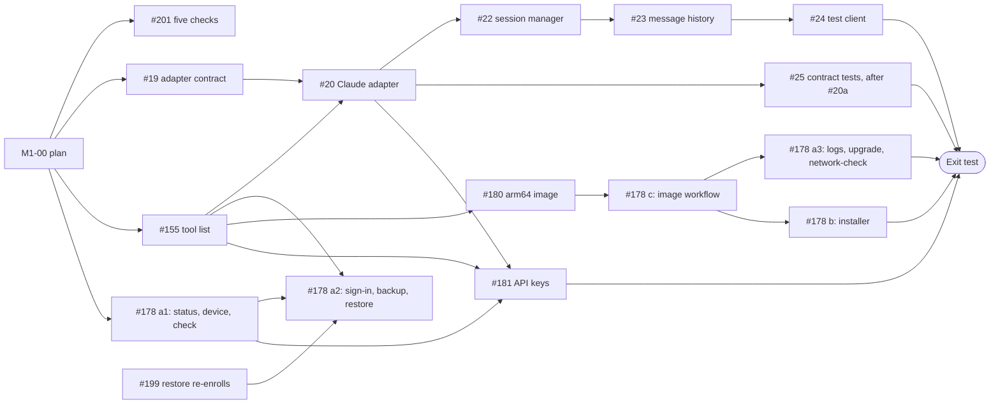

# M1 plan: One bot end to end

- Issue: [M1-00](https://github.com/jcore9/Aphelion/issues/18)
- Milestone: [M1 · One bot end to end](https://github.com/jcore9/Aphelion/milestone/2)
- Release: v0.1.0-alpha.2 ([decision 0003](../../decisions/0003-release-versioning.md))
- Status: Proposed. The owner approves this plan before any M1 work starts.
- Last updated: 2026-11-25

M1 builds the first bot. It also makes the server easy to install and to run. Approvals come in M2, so the bot's powers are fixed and small in M1 ([decision 0063](../../decisions/0063-m1-planning-answers.md)).

## Exit criterion

You chat with one Claude bot from a small terminal client. Text and tool activity stream as the bot works. The server saves the conversation, and a client that reconnects gets the activity it missed. A session resumes after a crash. A canceled session leaves no process behind.

M1 also ships four things around the bot:

- An AI tool is installed from a list, with a checksum. A checksum is a fingerprint of a download.
- An API key can be added, tested and removed.
- The `aphelion` command runs the server's tasks, and a one-line installer sets the server up.
- The image also builds for arm64. arm64 is the processor design of Apple Silicon, the Raspberry Pi 5 and many cloud servers. Most PCs use x86-64.

The [Exit test](#exit-test) runs all of this on the release image.

## Scope

### In scope

| ID | Issue | Wave | Depends on | Owner path |
| --- | --- | --- | --- | --- |
| M1-00 | [Milestone plan](https://github.com/jcore9/Aphelion/issues/18) (this document) | 0 | none | yes |
| M1-14 | [Require all five checks before merging](https://github.com/jcore9/Aphelion/issues/201) | 0 | none | yes |
| M1-01 | [Bot adapter contract](https://github.com/jcore9/Aphelion/issues/19) | 1 | M0-13 | no |
| none | [Install AI tools from a list](https://github.com/jcore9/Aphelion/issues/155) | 1 | M0-12 | yes |
| M1-08 | [A slow plugin start doesn't hold up others](https://github.com/jcore9/Aphelion/issues/167) | 1 | none | no |
| M1-13 | [Queue budget counts bytes](https://github.com/jcore9/Aphelion/issues/200) | 1 | none | no |
| M1-15 | [Plugin docs match the deployed host](https://github.com/jcore9/Aphelion/issues/202) | 1 | none | no |
| M1-16 | [Is the plugin-template check flaky?](https://github.com/jcore9/Aphelion/issues/203) | 1 | none | no |
| M1-09 | [`aphelion` command and installer](https://github.com/jcore9/Aphelion/issues/178), as parts a1 to a3, b and c | 1 to 3 | #155 for part a2 | part c |
| M1-02 | [Claude adapter](https://github.com/jcore9/Aphelion/issues/20) | 2 | M1-01, #155, M0-01 | yes |
| M1-10 | [arm64 image](https://github.com/jcore9/Aphelion/issues/180) | 2 | M0-12, #155 | yes |
| M1-12 | [A restore makes every device enroll again](https://github.com/jcore9/Aphelion/issues/199) | 2 | M0-12, #168, #177 | no |
| M1-04 | [Session manager](https://github.com/jcore9/Aphelion/issues/22) | 3 | M1-02, M0-12, M0-18 | no |
| M1-07 | [Adapter contract tests](https://github.com/jcore9/Aphelion/issues/25) | 3 | M1-02 | no |
| M1-05 | [Message history](https://github.com/jcore9/Aphelion/issues/23) | 4 | M1-04, M0-09 | no |
| M1-11 | [API keys](https://github.com/jcore9/Aphelion/issues/181) | 4 | #155, M1-02, part a1 | no |
| M1-06 | [Minimal test client](https://github.com/jcore9/Aphelion/issues/24) | 5 | M0-10, M1-05 | maybe |

M1-03 ([#21](https://github.com/jcore9/Aphelion/issues/21)) is closed as not planned ([decision 0034](../../decisions/0034-vendor-protocol-per-cli.md)). An **owner path** is a path that `.github/CODEOWNERS` names. The bot never merges a pull request that changes one. It waits for you. The paths are `.github/` (including `CODEOWNERS`), `release-please-config.json`, `.release-please-manifest.json`, every `package.json`, `bun.lock`, `bunfig.toml`, `eslint.config.ts`, `lint-boundaries.test.ts`, `vitest.config.ts`, every `tsconfig*.json`, `docs/decisions/`, `docs/plan/`, `SECURITY.md` and `LICENSE`.

Every other pull request is squash-merged by the bot after a review from another model family ([decision 0062](../../decisions/0062-one-main-branch.md)). Both trials that decision required passed on 2026-11-25: [#197](https://github.com/jcore9/Aphelion/pull/197) touched an owner path and was blocked (closed unmerged), and [#198](https://github.com/jcore9/Aphelion/pull/198) touched none and the bot merged it. So wave 1 can merge now.

"Maybe" means the pull request adds a `package.json`. #155 adds the tool list to `CODEOWNERS`, so after it merges, every edit to that list is an owner change, including #180's per-processor entries. Any decision record #22 needs is an owner change too. Each issue below says which of its pull requests wait.

### Out of scope

- Approvals, the policy engine and the managed hook (M2). In M1 the bot runs under a fixed rule ([Design notes](#the-first-bot-before-approvals)).
- Grok Build and Codex adapters (M4). #155 lists both tools, and #181 stores keys for any provider, but only Claude gets an adapter.
- The web client and the tool list screen (M5). M1 has the terminal client and the `aphelion` command.
- Plugins from other people (M5). [#182](https://github.com/jcore9/Aphelion/issues/182) and [#183](https://github.com/jcore9/Aphelion/issues/183) must land first.
- A coding app. Aphelion stays a bot application.

## Sequencing

#167, #200, #202 and #203 depend on nothing and don't appear in the graph.

| Wave | Starts when | Work |
| --- | --- | --- |
| 0 | You approve this plan | #201 (you approve it, because it touches `.github/`). A scripted sweep of the M1 to M9 issue bodies, described below. |
| 1 | Wave 0 is done, except #201, which waits only for you | #19, #155, #167, #200, #202, #203, #178 part a1 |
| 2 | #19 and #155 merge | #20, #180, #199, then #178 part c (after #180) and part a2 (after #199) |
| 3 | #20 merges, and #178 part c merges | #22, #178 part a3, #178 part b, and #25 (its recorded fixture waits for #20a) |
| 4 | #22 merges, and #20 and #178 part a1 are in | #23, #181 |
| 5 | #23 merges | #24 |
| Exit | Everything has merged | The [exit test](#exit-test) |

The dev box has 8 GB of memory, so at most two delegates run at once. **The sweep.** Many issue bodies in M1 to M9 still say "branch from `dev`" and "coding tools never approve or merge". [Decision 0062](../../decisions/0062-one-main-branch.md) changed both. A script edits each affected body to match. It runs once, before wave 1, and the bot lists the changed issues in the plan's retro.

### What changed against the issues' own "Depends on" lists

- #20 now also depends on #155. Its first acceptance line needs the pinned `claude` binary, and the tool list installs it.
- #181 also depends on #178 part a1, because the `aphelion key` commands live in the `aphelion` command. The issue already says so.
- #25 depended on #21, which is closed. It depends on #20 only. If #20 is split, #25 records its fixture after #20a (the adapter part), and #20 counts as done only when permission handling and replay both pass.
- #199 needs M0's backup, restore, device-token and plugin-approval code. It depends on #14, on #168 and #177 (the restore drill), and on the device and plugin-grant tables. It lands before #178 part a2 exposes `aphelion restore`. The issue now lists these.
- #23's issue gains the saved command IDs and the event format version, and #24's gains reconnecting. The M1 table in `docs/plan/aphelion-plan.md` now says #20 depends on #155 and #22 on M0-18.
- #178's installer, `upgrade` and `network-check` move to wave 3, because they use the image that part c publishes. Its `sign-in` moves to wave 2, because it needs #155.

## The first bot before approvals

The first bot may read and write files in its own working folder and run shell commands there ([decision 0063](../../decisions/0063-m1-planning-answers.md)). Aphelion's fixed answer to Claude's permission requests does the following.

- It allows the file tools inside the bot's folder.
- It denies the file tools outside the folder.
- It denies Claude's web tools.

The answer lives in the `canUseTool` function of #20. It gives the same answer for every request. It doesn't learn or widen. The SDK is the Claude Agent SDK, Anthropic's library for driving Claude Code.

**The limit, stated plainly.** Aphelion can't read what a shell command does. Only the file permissions of the `aphelion-bot` account and the container hold a shell command. A command can read other bots' folders and reach the internet. The container still keeps it from Aphelion's secrets and config. Only one bot exists in M1, so there is no other bot to read. M1 uses test data only. M2 puts each command behind your yes or no.

A bot can also read its own provider credential, which is the sign-in token or the API key. A tricked bot could leak it. A proxy can remove this later ([decision 0022](../../decisions/0022-bot-network-boundary.md), option 2).

## Design notes

Four notes end in a **Default**. The orchestrator chose it, and you can overrule it when you approve.

### Repeated commands after a restart

A client may send a command again, because the first reply got lost. The server must not run it twice. Today the server keeps command IDs in memory ([command-ledger.ts](https://github.com/jcore9/Aphelion/blob/main/packages/protocol/src/command-ledger.ts)). It forgets them when it evicts old ones or restarts.

**Default.** The server saves each state-changing command's ID and its result in its SQLite database for 24 hours. A repeat inside that time gets the saved result and has no second effect. #23 owns this, because it adds the tables for turns and events. Its test sends a command, restarts the server, sends the same ID again, and checks for one effect.

Cancel and start-session in #22 are safe to repeat on their own. A second cancel finds nothing to stop. A second start returns the running session.

### Sign-in or key

The sign-in wins. The key is used only when there is no working sign-in ([decision 0063](../../decisions/0063-m1-planning-answers.md)). #20 and #181 both implement this, and one test in #181 covers it.

**Default.** A provider may offer no lightweight key check. Aphelion then saves the key as "not tested". The first real use reports pass or fail. #181 checks each provider's options when it starts.

### Cancel must leave nothing running

A **process group** is a set of processes that one signal can reach. A bot's command can leave its group with `setsid` or become a daemon, so a group kill misses it. The M0 spike measured 2 of 5 processes left alive ([decision 0045](../../decisions/0045-no-bot-namespaces-default-seccomp.md)).

**Default.** The bar in #22 stays: no process survives, including one that leaves its group. #22 tries a **cgroup** per bot first. A cgroup is a Linux feature that groups processes so one action stops all of them. It needs delegation to work under the shipped container settings. If it doesn't, #22 walks the child processes, which can race. If nothing meets the bar on the shipped image, #22 stops and you decide in a decision record whether to accept the risk.

### One image, two processors

The image builds for x86-64 and arm64 from one `deploy/Dockerfile`. The tool list holds one URL and one checksum per processor ([decision 0060](../../decisions/0060-server-stays-on-linux-with-api-keys-and-two-plugin-fixes.md)). A tool with no arm64 download shows as unavailable on arm64.

**Default.** The arm64 checks run on GitHub's free hosted arm64 runners, because the repository is public. Emulation is slower and isn't used.

### How the installer gets the image

The release workflow builds the image and publishes it with its **digest**, a fingerprint of the image. It runs from the `release-please` job's release output in `release.yml`, so it fires when a release is made. The installer downloads the image and checks the digest. It refuses an image whose digest doesn't match. If the download fails, it builds the image on the server ([decision 0063](../../decisions/0063-m1-planning-answers.md)).

### Network check

Running `ufw reload` or `ufw enable` while Aphelion runs can remove the firewall rules that Aphelion and Docker added. Startup already refuses `MANAGE_BUILTINS=yes` ([#191](https://github.com/jcore9/Aphelion/issues/191)).

**Default.** `aphelion network-check` also looks for those lost rules and says which are missing.

### Order of `aphelion` commands

**Default.** Each group matches a part of #178:

1. `status`, `device` and `check` (part a1, wave 1).
2. `sign-in`, `backup`, `restore` and `plugin` (part a2, wave 2). `sign-in` needs the tool list from #155. `restore` waits for #199.
3. `logs`, `upgrade` and `network-check` (part a3, wave 3).

The `key` group lands with #181.

## Issues

Each section says what the issue builds, what it needs, which files it is expected to touch, and how it is checked. The file lists are expectations. A pull request may touch others.

### #201 Require all five checks before merging (wave 0, owner path)

- **Builds.** The `main` ruleset requires lint, typecheck, test, container and docs.
- **Needs.** Nothing.
- **Files.** `.github/rulesets/main.json`, `docs/branch-protection.md`.
- **Check.** After you apply the ruleset, a test pull request with a failing `container` or `docs` check shows as blocked. The bot reads `gh pr view N --json mergeStateStatus` and closes the test unmerged.

### #19 Bot adapter contract (wave 1)

- **Builds.** The plugin interface that emits normalized events: text delta, tool start and end, permission request, turn end, error and usage. It is the only thing a new bot tool must implement. M4 adds Grok and Codex behind it.
- **Needs.** M0-13, the plugin host.
- **Files.** `packages/plugin-sdk/src/`, `packages/protocol/src/`, `docs/reference/`.
- **Check.** Unit tests of the event shapes. A fake adapter passes the contract tests.

### #155 Install AI tools from a list (wave 1, owner path)

- **Builds.** A list of tools with pinned versions and per-processor checksums. The list is data, so a new tool is a new entry. Commands list the tools and install one. An install refuses a wrong checksum. Tools live in their own Docker volume, which bots can run but can't change. It survives an image upgrade. Tools update only through a new list entry. The list becomes an owner path in `CODEOWNERS`, and the bot opens a pull request for each version bump with the checksum checked against the vendor's download ([decision 0063](../../decisions/0063-m1-planning-answers.md)).
- **Needs.** M0-12, the image.
- **Files.** A new list file under `deploy/`, `apps/server/src/cli/`, `deploy/Dockerfile`, `.github/CODEOWNERS`, `docs/guides/install.md`.
- **Check.** A contract test installs a tool and runs it as `aphelion-bot`. Live: you install Claude Code from the list on a VM (a virtual machine, a computer simulated inside another).
- **Waits for you.** The `CODEOWNERS` change is in `.github/`.

### #167 A slow plugin start doesn't hold up others (wave 1)

- **Builds.** One ordered command queue per plugin, a launch deadline, and cleanup of a child that finishes late.
- **Needs.** Nothing.
- **Files.** `apps/server/src/plugins/runner.ts`, `apps/server/src/adapters/plugin-processes.ts`, `docs/reference/plugins.md`.
- **Check.** The two tests in the issue: a stalled launch for plugin A doesn't delay plugin B, and a timed-out run counts one failure.

### #200 Queue budget counts bytes (wave 1)

- **Builds.** The plugin queue limit counts UTF-8 bytes, in `apps/server/src/plugins/runner.ts`.
- **Check.** One test with ASCII text and one with multibyte text against the same budget.

### #202 Plugin docs match the deployed host (wave 1)

- **Builds.** The plugin guide and API reference say what works today. One example plugin runs against `createTestHost` and the real host.
- **Files.** `docs/guides/`, `docs/reference/`, `packages/plugin-sdk/src/testing.ts`.
- **Check.** The example's tests run against both hosts in CI, the automatic checks GitHub runs on every pull request.

### #203 Is the plugin-template check flaky? (wave 1)

- **Builds.** A measured failure rate on a small box and in CI. A fix, a new issue with the cause, or a close. The numbers go into the issue.

### #178 `aphelion` command and installer (waves 1 to 3, split in [five](#splits))

- **Part a1.** `status`, `device` and a `check` command that runs the exit test's checks. Files: new `deploy/host/aphelion`, `deploy/host/install`, `docs/guides/install.md`. Check: a shell test for each subcommand against the container.
- **Part a2.** `sign-in`, `backup`, `restore` and the `plugin` group. `sign-in` runs only the fixed sign-in command for a tool on the #155 list, as `aphelion-bot`, in your own terminal. `backup` keeps the previous verified copy until the new one verifies. `restore` runs the checks from #199 and waits for #199 to merge. Needs #155 for `sign-in`. Check: shell tests, plus a live backup and restore on two VMs.
- **Part a3.** `logs`, `upgrade` and `network-check`, with the lost-firewall check. Files: `deploy/host/network-check`, `deploy/host/aphelion`. Check: shell tests, plus a live `ufw reload` on a VM.
- **Part b.** The one-line installer. It runs `preflight`, checks the processor for `sse4_2`, installs Docker if missing, downloads Aphelion, writes `deploy/.env`, gets the image, enables the service, and walks you through saving the recovery key. It checks that key with the secrets broker's own parser. On x86-64 only, it first checks that the processor has `sse4_2`. It refuses an image whose digest doesn't match, and builds on the server when the download fails. Running it twice changes nothing. Check: the installer runs twice on a fresh VM, once with a wrong digest, and once with the download blocked.
- **Part c.** The image workflow. It builds both processors from the release job's release output, and publishes the image and its digest. Files: `.github/workflows/`. Check: a test release builds both images.
- **Waits for you.** Part c touches `.github/`. Parts a1 to a3 and b don't, unless they change a `package.json`.

### #20 Claude adapter (wave 2, owner path)

- **Builds.** The adapter plugin, using `@anthropic-ai/claude-agent-sdk` and the `claude` binary from #155. It answers every permission request with the fixed rule above. It answers the open points in [decision 0034](../../decisions/0034-vendor-protocol-per-cli.md). With fake keys, no key shows in output or logs, including at shutdown.
- **Constraints.** It sets the explicit path to the pinned `claude` binary on every call. The SDK is pinned to the matching CLI version, and the image leaves out the SDK's bundled copy. Managed settings ban the bypass modes (`auto` and `bypassPermissions`), and the adapter always passes `permissionMode: "default"`.
- **Needs.** #19, #155.
- **Files.** A new plugin folder under `apps/server/plugins/` or `packages/`, `bun.lock`, `docs/reference/`.
- **Check.** Unit tests of the permission answer: inside the folder, outside it, a web tool. A recorded SDK stream replays. Live: a real turn with a tool call on the shipped image.
- **Waits for you.** It adds a dependency, so `package.json` and `bun.lock` change.

### #180 arm64 image (wave 2, owner path)

- **Builds.** CI builds one image for both processors. The contract tests run on a hosted arm64 runner. The tool list gets per-processor entries.
- **Needs.** M0-12, #155.
- **Files.** `.github/workflows/ci.yml`, `deploy/Dockerfile`, the tool list, `docs/guides/install.md`.
- **Check.** `deploy/test/image-contract.sh` passes on arm64 in CI. Live: the arm64 smoke test in the exit test.
- **Waits for you.** It changes `.github/` and the tool list, both owner paths.

### #199 A restore makes every device enroll again (wave 2)

- **Builds.** A restore cancels every device token, and access stays closed until you enroll a device. Restored plugins start switched off, and the restore ends with a list of them.
- **Needs.** #14, #168 and #177 (the restore drill), and the device and plugin-grant tables. It lands before #178 part a2 exposes `aphelion restore`.
- **Files.** `apps/server/src/devices/`, `apps/server/src/plugins/`, `apps/server/src/cli/`, `docs/guides/install.md`.
- **Check.** A test shows an old token is refused. A test shows a restored plugin gets no start, secret or network until you switch it on. Live: the restore step of the exit test.

### #22 Session manager (wave 3)

- **Builds.** The bot runner, as `aphelion-bot`, starts one process per bot on the server's request. It restarts a crashed bot and resumes by session ID and working folder. Cancel leaves no process alive. A bot can't start, stop or cancel another bot. The bot runner already sits behind one message channel, so a bot on another server would use the same channel later ([decision 0064](../../decisions/0064-linked-equal-servers.md)). M1 adds nothing for that.
- **Constraints.** The runner keeps the init-created pipe. Only the runner signals bot processes. Bot egress goes only through the proxy variables. Default seccomp, and no bot namespaces ([decision 0045](../../decisions/0045-no-bot-namespaces-default-seccomp.md)).
- **Needs.** #20, M0-12, M0-18.
- **Files.** `apps/server/src/plugins/runner*.ts` or a new `apps/server/src/bots/`, `deploy/Dockerfile`, `docs/reference/`.
- **Check.** A test starts a process that leaves its group with `setsid`, cancels, and checks that none survive. The same test runs on the shipped image. Live: kill the bot process and see it resume.
- **Waits for you.** Only if no method meets the bar. Then a decision record decides, and the record is an owner change.

### #25 Adapter contract tests (wave 3)

- **Builds.** Recorded event streams replayed in CI. The recorded fixture is made after #20a, the adapter part.
- **Needs.** #20.
- **Files.** `packages/plugin-sdk/src/`, a `fixtures/` folder.
- **Check.** The replay runs in CI and fails when an event changes shape.

### #23 Message history (wave 4)

- **Builds.** Turns and events saved in SQLite. A reconnecting client gets the missed events. The saved command IDs for 24 hours, from the design note above. The groundwork from [decision 0064](../../decisions/0064-linked-equal-servers.md) ([#205](https://github.com/jcore9/Aphelion/issues/205), the M4 design study, and [#206](https://github.com/jcore9/Aphelion/issues/206), the build after v1.0): a stable server ID created on first start and stored in the database, IDs such as UUIDv7 for every new table instead of counting 1, 2, 3, and a column on each saved record that names the server that wrote it. Saved events carry a format version number, so M5 clients can read M1 history. The audit log keeps its integer IDs, and moving it is a known migration for later.
- **Needs.** #22, M0-09.
- **Files.** `apps/server/src/store/migrations/`, `apps/server/src/http/`, `packages/protocol/src/event-log.ts`, `packages/protocol/src/command-ledger.ts`.
- **Check.** A test disconnects a client mid-turn and checks the replay. A test restarts the server and repeats a command ID. A test checks that the server ID survives a restart, and that two fresh databases make different IDs.

### #181 API keys (wave 4)

- **Builds.** `aphelion key add`, `test`, `replace` and `remove`, with the key stored by the broker. The Claude adapter hands the key to the CLI as an environment setting when no sign-in works. The key stays in the `Secret` wrapper until then.
- **Constraints.** The key is typed into a hidden prompt, never the command line. The masking from [decision 0044](../../decisions/0044-secret-type.md) holds through shutdown. A bot can read its own key.
- **Needs.** #155, #20, #178 part a1.
- **Files.** `apps/server/src/secrets/`, `apps/server/src/cli/`, the Claude adapter, `docs/guides/install.md`.
- **Check.** Automated tests use fake keys, and one checks that none shows in output, errors, logs or at shutdown. Live: you add a throwaway test key with a small spending limit and run the check yourself.

### #24 Minimal test client (wave 5, maybe an owner path)

- **Builds.** A terminal chat client that shows streaming text and tool events, and reconnects after a drop and shows what it missed.
- **Needs.** #23, M0-10.
- **Files.** A new client folder, perhaps `packages/test-client/`.
- **Check.** An automated chat against a fake adapter. Live: the exit test.
- **Waits for you.** A new folder with its own `package.json`.

## Splits

Propose these. The orchestrator files them after you approve.

**#178 into five sub-issues.** The issue covers a command, an installer and a release workflow. Those three differ in risk, and the workflow is an owner path.

| Sub-issue | Covers | Wave |
| --- | --- | --- |
| #178a1 | `aphelion` command with `status`, `device` and `check` | 1 |
| #178a2 | `sign-in`, `backup`, `restore`, `plugin` (after #199) | 2 |
| #178a3 | `logs`, `upgrade`, `network-check` | 3 |
| #178b | The one-line installer | 3 |
| #178c | The image workflow | 2 |

**#20 into two.** #20a is the adapter streaming a turn. #20b is the permission rule and its tests. #20 counts as done only when both parts and the replay pass. Both fit one pull request each, and #20b is the part you most want to read.

**#22 into two.** #22a is the runner start, restart and resume. #22b is cancel with no leftover process. #22b carries the risk and its own live test.

## Risks

| Risk | Effect | Mitigation |
| --- | --- | --- |
| A canceled bot leaves a detached process | A process keeps running after you cancel | The bar in #22 is strict and tested on the shipped image. If nothing meets it, you decide in a record. |
| A shell command can reach the internet and other bots' folders | A tricked bot can leak what it can read | One bot, test data only, and the container keeps Aphelion's secrets away ([decision 0063](../../decisions/0063-m1-planning-answers.md)). M2 adds approvals. |
| Claude Code and the Agent SDK change between versions | The adapter breaks on an upgrade | Both are pinned and updated together. The recorded-stream tests catch a changed shape. |
| The 8 GB dev box | A full lint or two builds can run it out of memory | At most two delegates at once. No full local lint. CI runs it. |
| Some tools have no arm64 download | The tool shows as unavailable on arm64 | #155 marks it, and #180 checks each pinned tool. |
| A vendor's checksum or download changes | An install fails, or an update installs the wrong file | The bot's version-bump pull request verifies against the vendor, and you approve it. |
| Linking equal servers later means syncing data | A table that counts rows 1, 2, 3, or that assumes one server, needs a migration once servers link | M1 adds no such table. New tables use IDs that can't clash and name the server that wrote each record ([decision 0064](../../decisions/0064-linked-equal-servers.md)). The audit log is a known migration for later. |
| The M0 reviewers didn't repeat the live host checks | Isolation or tailnet-only access may have drifted | The exit test runs them again on the release image. |

## Open questions

None remain from the M1 outlook. You answered five on 2026-11-25. [Decision 0063](../../decisions/0063-m1-planning-answers.md) records them. The Design notes mark six defaults you can overrule: the arm64 runners, the "not tested" key, the 24-hour command IDs, the lost-firewall check, the command order and the cancel bar.

## What I need from you

1. Approval of this plan, including the splits and the defaults in the Design notes. Say which defaults you change.
2. Apply the updated `main` ruleset from #201 once it merges.
3. For the exit test: a fresh Ubuntu LTS VM on your tailnet, a second one for the restore, and an arm64 machine or VM.
4. For the live key check: a throwaway Anthropic API key with a small spending limit.

## Exit test

Run on the release image, on a fresh Ubuntu Server LTS VM with Tailscale. Use test data only. Each step gives what to type and what you must see. Part A is the smoke test. Run it on x86-64, then again on arm64. Part B runs once. The output of each step goes into the retro note.

### Part A: smoke test

1. Run the one-line installer. On x86-64 it first checks the processor for `sse4_2` (arm64 skips this). It downloads the image and checks the digest. Expect: the service runs, and you save the recovery key.
2. Run the installer a second time. Expect: nothing changes.
3. `aphelion status`. Expect: the service is up and no AI tool is installed.
4. Install Claude Code from the list, with the command in the install guide. Expect: the checksum is verified and the tool is installed.
5. `aphelion sign-in claude`. Expect: you sign in in your terminal, and `aphelion status` shows Claude signed in.
6. `aphelion device add`, then get and start the test client as the guide says. Expect: the client connects.
7. Chat with the bot and ask it to make a file in its folder. Expect: streamed text and tool events.
8. Disconnect the client mid-turn, then reconnect. Expect: the missed events arrive, with none repeated.
9. Kill the bot process. Expect: the bot resumes the session.
10. Cancel a turn that started a detached process. Expect: no bot process is left (`ps` shows none).

### Part B: once, on x86-64

11. Installer safety. Point the installer at an image with a wrong digest. Expect: it refuses. Block the image download. Expect: it builds the image on the server.
12. Your live key test, with a throwaway API key that has a small spending limit. Add the key while a sign-in exists: the bot uses the sign-in. Remove the sign-in: the bot uses the key. Run `aphelion key remove`: the bot reports no credential. Expect each result.
13. Fake-key leak check. Add a fake key. Search the output, errors and logs, through a shutdown. Expect: the key appears nowhere.
14. Bot permission probes. Ask the bot to write a file outside its folder, to use a Claude web tool, and to write a file inside its folder. Expect: the first two are denied and the third works.
15. Restore. Seed a backup with one device and one approved plugin. Restore it with the recovery key on the second VM. Expect: the old device token fails, and the plugin is switched off. It gets no secret and no network access until you switch it on.
16. Network. Run `ufw reload`, then `aphelion network-check`. Expect: it names each lost rule. Repeat the six connects from [decision 0022](../../decisions/0022-bot-network-boundary.md) as `aphelion-bot`. Expect: the first five fail. Reach the server from a device off the tailnet. Expect: no answer.
17. Docker isolation, from inside the container. Expect: the host's files and sockets are out of reach.

**What only CI can prove.** Link the passing CI run on the release commit. It must show: saved command IDs surviving a restart, server IDs on records, adapter replay, the fixes from #167 and #200, and all five required checks.

## Docs M1 produces

- The install guide, with `aphelion` commands in place of Docker steps, and the bot's powers and their limit.
- The adapter contract, Claude adapter, session and history references, and the test client guide.
- Decision records 0063 and 0064, any record #22 needs, and the changelog in the M1 release PR.

## Retro

Written when M1 closes.
